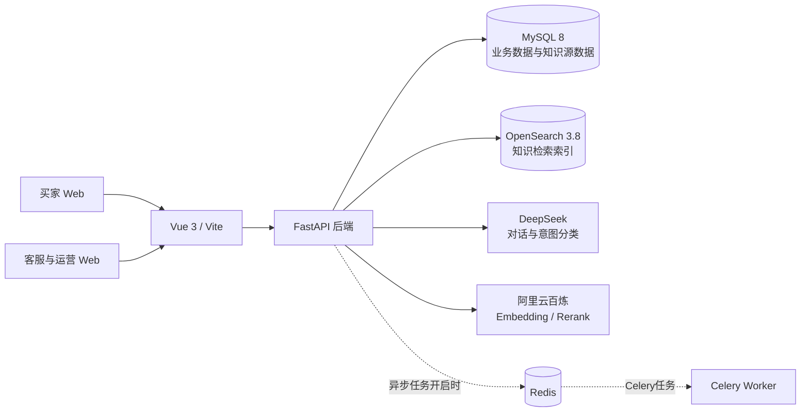
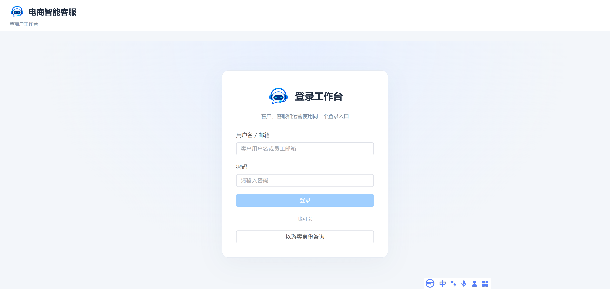
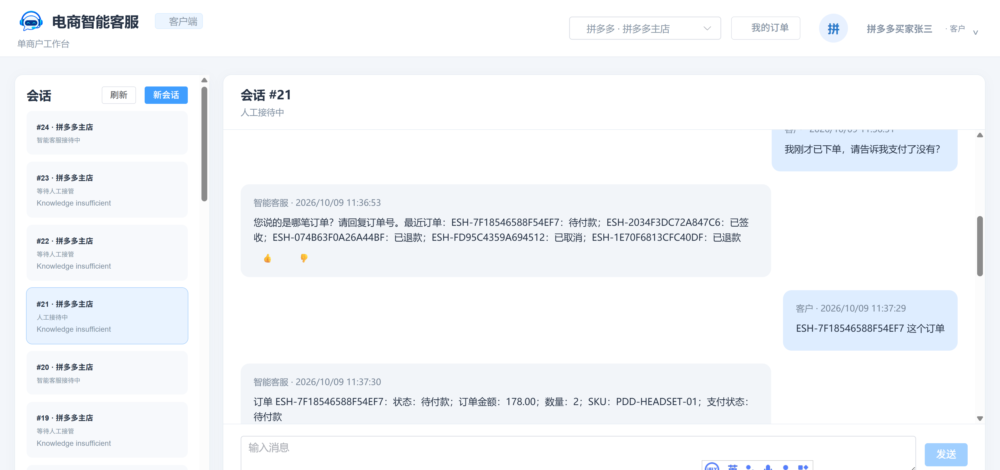
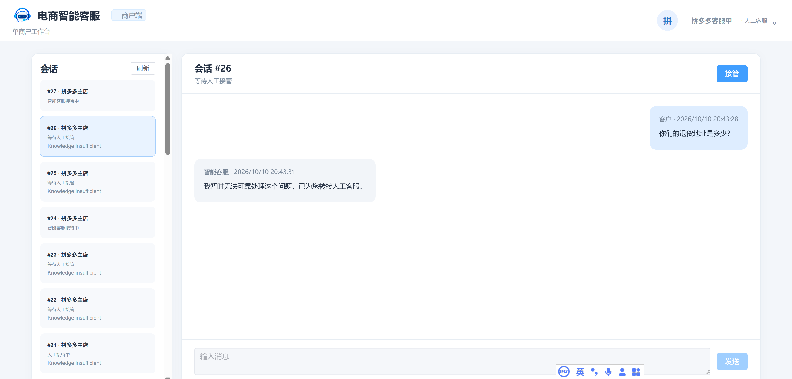
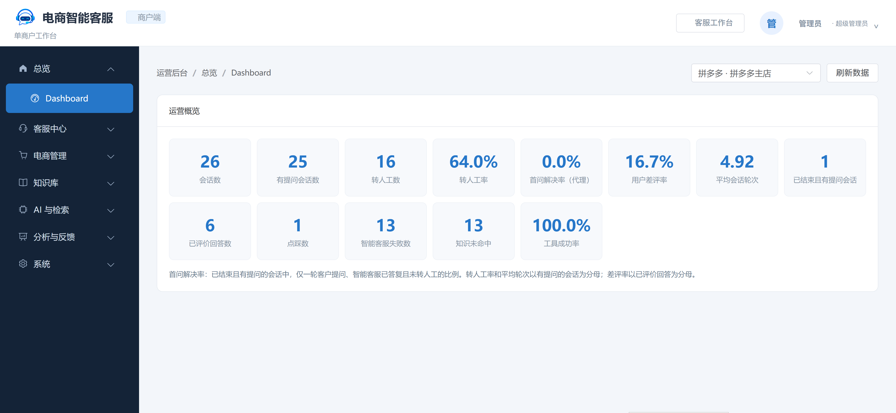
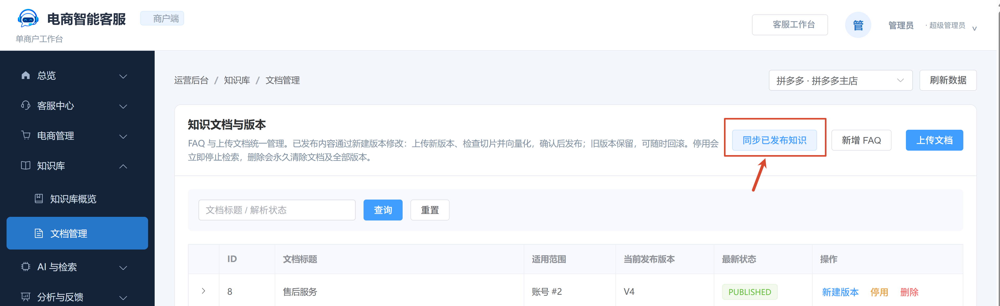

# 电商智能客服 AgentServe

> 本项目当前改造进度及启动方式见[后端基础改造交付说明](./FOUNDATION.md)，真实模型及知识首批见[模型与知识交付](./MODELS_KNOWLEDGE.md)，五模块设计预览见[前端预览说明](./FRONTEND_PREVIEW.md)。下文保留上游项目介绍与原版运行说明，不代表本项目所有能力已完成验收。

> 首次克隆请按[根目录 README](../README.md)运行当前版本。原上游 SQL 转储含历史聊天与请求载荷，不随本仓库分发；下文原版 SQL 导入步骤仅供历史参考。当前版本通过迁移初始化，不依赖该文件。

面向电商商家的智能客服与运营管理系统，支持拼多多演示场景。项目提供买家咨询、知识检索、订单查询、人工客服协同，以及后台知识和运营数据管理能力。

## 1. 项目介绍

### 主要功能

- **智能客服**：买家可发起会话，系统结合知识库回答问题，并提供知识来源和反馈入口。
- **电商业务演示**：提供拼多多演示买家、客服与订单数据，可在运营后台查看和管理商品、订单、客户等信息。
- **人工客服协同**：客服可查看会话并接手需要人工处理的问题。
- **知识库管理**：支持 FAQ 和文档切片管理、知识版本发布与回滚；已发布知识可从 MySQL 同步到 OpenSearch。
- **模型与检索**：支持 DeepSeek 对话模型，以及阿里云百炼 Embedding 和 Rerank。
- **可观测与管理**：提供提问路由记录、运行分析、用户反馈、系统配置和权限管理等后台页面。
- **可选异步处理**：Celery 使用 Redis 作为任务队列。默认关闭异步上传；启用后需另行启动 Celery worker。

### 技术架构



MySQL 保存业务数据、知识版本、文档切片及向量；OpenSearch 为知识检索提供索引。Redis/Celery 只用于可选的异步文档处理。OpenSearch 重建或清空后，可在运营后台“知识库 → 文档管理”使用“同步已发布知识”恢复索引。

## 2. 在线演示

**演示地址：**<http://47.96.14.88:6173/>

**视频演示：**[哔哩哔哩观看](https://www.bilibili.com/video/BV1rPpb6kEay)

演示环境供体验和学习使用，账号及数据为公共演示内容，可能被其他访问者查看、修改或清理。请勿随意添加无关测试数据，也不要录入真实个人信息、联系方式、订单信息、密码、密钥等敏感数据，或发布违法违规内容。用户需对自行提交的数据及操作负责；由此产生的违规或其他后果由用户承担。

| 角色 | 账号 | 密码 |
| --- | --- | --- |
| 运营 / 管理员 | `admin@demo.local` | `请使用本机配置的密码，不随仓库分发` |
| 拼多多买家 | `pdd-buyer-1001` | `DJjBs4DnUmUsF6TQpoo` |
| 拼多多客服甲 | `pdd-agent-a` | `oKfnIxDr5DgGXKgNYqA` |
| 拼多多客服乙 | `pdd-agent-b` | `JR_eVGiHu1nAJJrquaI` |

## 3. 快速入门

### 环境要求

| 软件 | 版本 / 用途 |
| --- | --- |
| 操作系统 | Windows 10 或更新版本；Linux |
| Python | 3.11 或更新版本 |
| Node.js | 22 或更新版本 |
| pnpm | 用于安装前端依赖 |
| MySQL | 8.x，必需 |
| OpenSearch | 3.8.0，必需 |
| Redis | 可选；仅异步任务队列需要，默认关闭 |

### 安装 OpenSearch 3.8.0

OpenSearch 默认只绑定本机地址，供本机后端访问。

**Linux：**

```bash
wget https://artifacts.opensearch.org/releases/bundle/opensearch/3.8.0/opensearch-3.8.0-linux-x64.tar.gz
tar -zxvf opensearch-3.8.0-linux-x64.tar.gz
sudo mkdir -p /data/soft
sudo mv opensearch-3.8.0 /data/soft/opensearch-3.8.0
```

**Windows：**下载 [OpenSearch 3.8.0 Windows ZIP](https://artifacts.opensearch.org/releases/bundle/opensearch/3.8.0/opensearch-3.8.0-windows-x64.zip)，解压并将安装目录放到：

```text
D:\soft\opensearch-3.8.0
```

克隆源码后，用项目提供的本机开发配置替换 OpenSearch 配置：

```bash
# Linux
cp scripts/opensearch.yml /data/soft/opensearch-3.8.0/config/opensearch.yml
```

```powershell
# Windows PowerShell
Copy-Item scripts\opensearch.yml D:\soft\opensearch-3.8.0\config\opensearch.yml -Force
```

该配置关闭 OpenSearch 安全插件，并只监听本机地址，适合本地演示和开发。不要将此 OpenSearch 端口直接暴露到公网。

### 下载源码

```bash
git clone https://gitee.com/usefullc/agent-serve.git
cd agent-serve
```

### 创建 Python 环境并安装后端依赖

**Windows PowerShell：**

```powershell
powershell.exe -NoProfile -ExecutionPolicy Bypass -File scripts\setup_python_windows.ps1
```

**Linux：**

```bash
bash scripts/setup_python_linux.sh
```

脚本会在项目根目录创建 `.venv` 并安装 `backend/requirements.txt` 中的依赖。

### 安装前端依赖

确保 Node.js 22+ 和 pnpm 已安装，然后运行：

```bash
cd frontend
pnpm install
cd ..
```

### 配置环境变量

复制根目录的 `.env.example` 为 `backend/.env`，填写本机配置：

```powershell
# Windows PowerShell
Copy-Item .env.example backend\.env
```

```bash
# Linux
cp .env.example backend/.env
```

至少配置以下项目：

- `DATABASE_URL`：MySQL 连接地址。
- `OPENSEARCH_URL=http://127.0.0.1:9200`：OpenSearch 地址。
- `LLM_BASE_URL`、`LLM_API_KEY`、`LLM_MODEL`：DeepSeek 对话模型。
- `EMBEDDING_BASE_URL`、`EMBEDDING_API_KEY`、`EMBEDDING_MODEL`、`EMBEDDING_DIM`：阿里云百炼 Embedding。
- `RERANK_URL`、`RERANK_API_KEY`、`RERANK_MODEL`：阿里云百炼 Rerank。
- `REDIS_URL`：启用异步上传或使用失败版本重试时需要；默认 `ASYNC_INGESTION=false`。
- `JWT_SECRET`、`CUSTOMER_TOKEN_SECRET`：请设置为随机长密钥。

LLM、Embedding 和 Rerank 官方文档： [DeepSeek Chat Completions](https://api-docs.deepseek.com/zh-cn/api/create-chat-completion) · [阿里云百炼文本 Embedding](https://help.aliyun.com/zh/model-studio/text-embedding-synchronous-api) · [阿里云百炼文本 Rerank](https://help.aliyun.com/zh/model-studio/text-rerank-api)。

> 请勿将真实 API Key、数据库密码或生产密钥提交到 Git。

### 初始化数据库

先在 MySQL 创建数据库，再导入仓库中的演示数据：

```sql
CREATE DATABASE agentserve CHARACTER SET utf8mb4 COLLATE utf8mb4_unicode_ci;
```

Linux：

```bash
mysql -u root -p agentserve < backend/db/agentserve.sql
```

Windows PowerShell：

```powershell
cmd /c "mysql -u root -p agentserve < backend\db\agentserve.sql"
```

数据库连接账号需要与 `backend/.env` 中 `DATABASE_URL` 的账号密码一致。

### 启动服务

在**项目根目录**分别启动后端、前端和 OpenSearch。

| 服务 | Windows PowerShell | Linux |
| --- | --- | --- |
| 后端 | `powershell.exe -NoProfile -ExecutionPolicy Bypass -File scripts\service.ps1 backend start` | `bash scripts/service.sh backend start` |
| 前端 | `powershell.exe -NoProfile -ExecutionPolicy Bypass -File scripts\service.ps1 frontend start` | `bash scripts/service.sh frontend start` |
| OpenSearch | `powershell.exe -NoProfile -ExecutionPolicy Bypass -File scripts\service.ps1 opensearch start` | `bash scripts/service.sh opensearch start` |

统一服务脚本也支持 `stop` 和 `status`，例如：

```bash
bash scripts/service.sh backend status
bash scripts/service.sh frontend stop
```

Windows 对应使用 `scripts\service.ps1`。OpenSearch 默认安装位置为 Linux `/data/soft/opensearch-3.8.0`、Windows `D:\soft\opensearch-3.8.0`；安装在其他位置时，可设置 `OPENSEARCH_HOME`。日志和 PID 文件分别写入 `var/log/` 与 `var/run/`。

### 本地登录与演示账号

本地启动后，打开统一登录页面：<http://localhost:6173/>。本地演示数据库使用以下账号：

| 用户名 | 默认密码 | 角色 |
| --- | --- | --- |
| `admin@demo.local` | `请使用本机配置的密码，不随仓库分发` | 运营 / 管理员 |
| `pdd-buyer-1001` | `DJjBs4DnUmUsF6TQpoo` | 拼多多买家 |
| `pdd-agent-a` | `oKfnIxDr5DgGXKgNYqA` | 拼多多客服甲 |
| `pdd-agent-b` | `JR_eVGiHu1nAJJrquaI` | 拼多多客服乙 |

以上为本地演示账号。公开部署前请更换或禁用这些账号与默认密钥。

登录运营账号后，进入“知识库 → 文档管理”，点击“同步已发布知识”，将 MySQL 中已发布的知识切片恢复到 OpenSearch。同步不会为缺少向量的切片重新生成 Embedding。

#### 页面预览

**统一登录**



**买家界面**



**客服界面**



**运营 / 管理界面**



**同步已发布知识到 OpenSearch**



## 4. 问题与讨论

- 使用过程中遇到问题或发现缺陷，请在仓库提交 [Issue](https://gitee.com/usefullc/agent-serve/issues)。描述问题时请附上操作步骤、错误日志和运行环境；请勿上传密码、API Key 等敏感信息。
- 也可以扫码联系作者：


