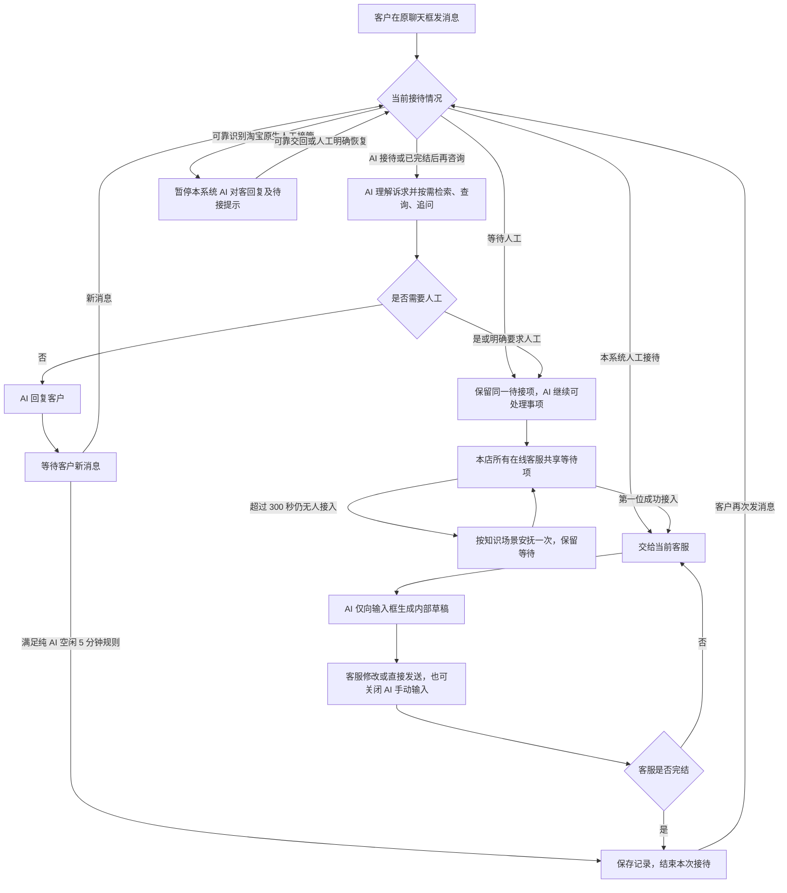

# 第一版功能流程

本文件回答：用户触发什么操作，页面和系统怎样响应。它是已确认需求的功能整理，不是接口、数据库或详细 Agent 工作流设计。业务职责见[业务流程](./第一版业务流程.md)，逐项范围见[功能清单](./第一版功能清单.md)。

依据：[产品定义](./第一版产品定义.md)、[功能来源对照](./第一版功能来源对照.md)。下图为目标流程，含尚未开发及待验证能力；“现有”也不代表已运行验收。

## 1. 总体接待流程

箭头表达接续关系。连接失效、生成失败等分支在下文单列；人工接待和人工等待均不走纯 AI 空闲完结。

## FF-01：店铺开通、登录与共享设置

1. 产品方内部开通店铺租户及初始账号；店铺端不出现公开注册、租户运营或迁移入口。
2. 客服登录对应店铺，读取本店共用的知识、政策、AI 配置和 Prompt；个人接待、工作状态及输入草稿分别管理。
3. 同账号在新端成功登录后，新端接替旧端；旧端停止接待操作，已有会话仍属于该账号。正常换端不误触发失联补位。
4. 所有店铺客服使用同一种角色，可在本店账号入口开通／停用本店账号。停用沿用原工程语义，阻止登录及回复等受保护操作。
5. 淘宝授权、模型配置和知识准备在相应设置／知识入口完成。授权失败不显示成已连接；实际能力按联调结果展示。

来源：登录、账号维护已有；统一角色、租户认证和隔离需改造；单一接待端需新增。真实淘宝授权待验证。

## FF-02：接收消息与 AI 接待

| 顺序 | 触发与系统响应 |
| --- | --- |
| 1 | 识别消息所属店铺、客户、当前接待及平台原生接管情况；客户持续使用原聊天框 |
| 2 | 记录消息并展示可用的文字、图片及商品／订单卡片；真实平台消息类型和权限待验证 |
| 3 | 人工接待中交当前客服；等待中保留原等待项并继续 AI 可处理事项；已完结后新消息恢复 AI 接待 |
| 4 | AI 理解当前诉求，按需检索可见场景指引、适用政策、商品备注及相关历史，必要时查询实际业务信息或追问 |
| 5 | 可靠可答则发送 AI 回复；需要人工则带主要诉求、相关订单、已确认内容和待解决问题进入 FF-03 |
| 6 | 对查询和处理结果保留可靠来源；查询成功不等于售后审批或资金执行成功 |

明确要求人工时直接进入共享待接，不强制先回答一轮。多订单、部分数量和混合售后在同一次事件内表达，不强制让客户先选一个订单。

来源：消息、查询工具、检索和路由已有基础；等待时 AI 继续服务、多订单、历史使用需改造或新增；真实淘宝查询、图片／卡片需新增并验证。

## FF-03：共享等待、唯一接入与 300 秒提示

1. 创建或复用本次人工客服等待项，在本店所有在线客服列表中显示主要诉求和“接入”。不创建独立审核、派单、转接或容量入口。
2. 任何具备接入资格的在线客服都可以尝试接入；只允许第一个成功者成为负责人。其他端刷新为已被接入，不再允许发送或重复接入。
3. 无人在线或无人接入时保留等待；AI 可继续回答已确认部分和补问信息，不能因此重复产生人工请求。
4. 从进入等待起超过 300 秒仍无人接入，触发预置等待场景，检索客服知识库生成一次安抚；知识或模型不可用，使用固定提示。
5. 提示实际发出前核对接待情况。人工已接入或可靠识别淘宝原生人工接管，则取消迟到的待接提示。一次等待不重复发送定时安抚。
6. 安抚之后仍可接入，不自动完结、不重新轮询；后续接入按同一唯一接入规则处理。

来源：唯一接入的原子保护已有，保留并验证；同租户在线共享待接需改造；300 秒场景及取消迟到提示需新增。

## FF-04：人工工作台与 AI 输入框

工作台：左侧会话列表，中央本次消息和输入框，右侧“处理记录／相关订单”页签。在线、等待接入、已完结有明确样式；消息按原顺序展示，并标明此前 AI 接待阶段。

### 输入框交互

| 状态／操作 | 页面与系统响应 |
| --- | --- |
| 接入或重新开启辅助 | 为最新未答内容生成草稿；已答内容不重复补答；连续客户消息合并考虑 |
| AI 正在生成 | 输入框暂时只读，显示“AI 正在生成回复”；“关闭 AI，手动回复”始终可用 |
| 生成完成 | 文字留在输入框，可修改、清空或直接点击发送；不另设“采纳”按钮 |
| 客服发送 | 以当前客服身份发送输入框内容，保存实际发送记录；AI 生成完成本身不触发对客发送 |
| 关闭辅助 | 停止本会话生成，保留已有文字并立即允许编辑；迟到结果不能覆盖输入 |
| 生成失败或超时 | 恢复人工编辑，保留可用文字；不能持续锁住输入框 |
| 已在人工编辑 | 新生成内容不能覆盖；不增加专门更新流程，客服需要时关闭再开启辅助 |
| 清空内容 | 不立即自动补回；可用原生撤销或关闭再开启 AI，程序填入后的原生撤销效果需验证 |
| 切换会话 | 当前接待端按客服和会话分别保留草稿；不要求关页或换设备恢复 |

### 查看与记录

- 默认查看本次聊天。满足此前同一客服、同一客户条件时展示历史关联；AI 的按需历史读取范围另见 FF-07。
- 相关订单展示授权可得的订单编号、商品及数量等，平台卡片与商品业务备注关联展示。
- 处理记录展示接待事件、可靠取得的查询／处理结果及选填客服备注，区分来源、作者、时间。备注不等于平台确认结果。
- 复用既有日志和查询记录，不为处理记录新增业务模型、表或独立任务台账；需补相应呈现与备注操作。
- 人工会话由当前客服手动完结，不因长时间无消息自动结束。需要等待外部办理时可继续在线。

来源：人工发送、完结、消息记录已有；列表、草稿隔离需改造；AI 输入框、侧栏呈现及备注操作需新增。

## FF-05：完结、重开与三类时间规则

| 规则 | 适用前提 | 到时或触发后的响应 |
| --- | --- | --- |
| 纯 AI 空闲 5 分钟 | AI 已答复、无人工等待，客户最后一次消息后 5 分钟没有新消息 | 结束本次接待并轻提示；规则在设置页只读展示，时长写在代码中 |
| 人工等待超过 300 秒 | 仍无人接入 | 安抚一次，保留等待；不适用纯 AI 空闲自动完结 |
| 服务连接失效 30 秒 | 实际接待连接中断，重连宽限仍未恢复 | AI 补位，客服恢复后明确接回；不自动变成已完结 |

虽然 5 分钟与 300 秒数值相同，前者是结束纯 AI 接待，后者是安抚人工等待，必须分别判断。

| 重开入口 | 响应 |
| --- | --- |
| 已完结后客户新消息 | 默认 AI 接待，需要人工再进入 FF-03；客户聊天框保持连续 |
| 未完结人工会话中的客户消息 | 交当前负责人，AI 仅内部辅助；失联／原生接管按 FF-06 处理 |
| 客服在历史人工会话中选择重新发起 | 选择继续原记录或创建新事件，再按当前接待情况校验，不能形成两名客服同时接待 |
| 客户主动结束 | 仅依据平台可靠提供的结束／退出信号处理；平台能力待验证 |

来源：人工手动完结已有；关闭后消息、历史重开需改造；三个定时规则需新增。

## FF-06：在线状态、失联与原生接待

| 情况 | 响应与边界 |
| --- | --- |
| 手动设为离线 | 不再作为新接入的在线客服，已有会话仍可处理和手动完结；不触发 AI 补位 |
| 网页／程序关闭、真实服务连接中断 | 进入 30 秒重连宽限；恢复则继续，超时由 AI 补位；恢复后客服明确接回 |
| 同账号正常换端 | 新端延续该账号接待，旧端停止操作；不能误当真正失联 |
| 账号被停用 | 沿用原工程阻止登录、接入、回复等受保护操作；实际连接失效按通用补位规则处理，不另设停用交接流程 |
| 可靠识别淘宝原生端人工回复／接管 | 暂停本系统 AI 对客回复、等待安抚与新接入通知，保留记录和原生处理标识 |
| 原生接待结束／交回 | 依据可靠事件或人工明确操作恢复，不依据短暂无消息推测 |
| AI 模型或知识服务异常 | 不影响可用消息通道下的人工手动回复；AI 接待需人工时复用／创建同一等待项，无人时固定提示，恢复后不抢回人工会话 |
| 整个消息通道不可用 | 明确发送失败／不可用，不将未送出的内容记录为已成功送达 |

来源：账号停用已有；在线状态、失联补位和单端接替需新增；淘宝原生事件需新增并验证。提示文字和明确恢复入口的页面细节留待页面设计，不增加新的派单分支。

## FF-07：客服知识库维护、试问与发布

1. 从统一知识入口查看平台政策、店铺政策、场景指引、商品业务备注。平台公共资料由产品方维护；店铺客服共用并维护本店内容。
2. 店铺政策通过选填问答、自由补充或可选 Markdown 导入建立；商品备注选择适用商品／规格、填写业务内容，保留作者及更新时间。
3. 保留原工程自动处理、片段编辑和向量化能力。原有明确提交的片段操作按其结果保留，不增加编辑页自动保存。
4. 编辑时可直接“试问 AI”：当前编辑内容临时用于本次试问，其他适用的已发布知识仍可参与；支持连续追问、清空。试问不能发送给真实客户、创建真实人工待接或执行真实业务写入。
5. 可直接发布生效，不要求先试问或点击保存草稿；保留必要发布校验。商品备注提交即生效。离开编辑页，未提交修改丢弃。
6. 可选生效／失效时间，不填长期有效；到期从当前知识检索中退出，记录保留，不自动恢复旧内容。新回复取适用已发布内容，已发消息不变，在途回复沿用启动时内容。
7. 只提供恢复上一已发布版本，恢复保留该版本原失效时间；已过期内容不会因恢复变成长期有效。
8. 预置路由目录和用途可见、只读；店铺通过编辑对应场景指引影响处理方式，不编辑路由条件、跳转或向量索引字段。
9. 保留现有提问路由分析及历史依据快照；不新增会话内完整参考资料面板，不擅自删除原有简要知识来源折叠。

**历史使用范围：** AI 可按需读取同店、同客户、相关订单／事件的既往聊天，包括人工内容及当时引用过、现已过期的知识。此历史引用不恢复原知识有效性，不扩大到其他客户或店铺。

来源：上传、切片、检索、有效期和分析已有；组织方式、发布／恢复、召回测试升级需改造；政策问答、商品备注、路由目录和相关旧聊天读取需新增。

## FF-08：AI 配置、Prompt、招呼与反馈

| 入口 | 操作及生效范围 |
| --- | --- |
| AI 模型配置 | 同店共用对话推理、向量化、重排序三类配置，Key 可相同或不同；对话服务商限 DeepSeek／百炼千问，展示已适配模型及默认推荐。检索模型兼容性按实际验证，不将一把 Key 视为支持全部能力 |
| Key 展示 | 后端加密保存，页面保存后掩码展示，不返回完整密钥，不写入普通日志；不提供任意接口地址、充值或套餐管理 |
| Prompt 模板 | 可查看并完整编辑预置模板，直接保存生效；当前编辑内容可试问。找回原文联系产品方，不另建自助恢复界面 |
| 自动打招呼 | 配置开关和固定文案，不调用模型；客户打开聊天未发消息时同次一次，人工接待中不插入，与平台欢迎语去重。开窗事件和发送能力待验证 |
| 接待规则说明 | 至少展示已确定的纯 AI 空闲 5 分钟规则及适用条件，时长不可自定义；其他固定规则在相应说明中写清 |
| AI 回复反馈 | 保留单条 AI 回复赞／踩；真实淘宝侧入口待验证，不增加整次服务评价 |

来源：模型调用、Prompt 全文编辑、单条反馈已有；按店铺配置凭据、模型列表和试问需改造；招呼、规则说明需新增。

## FF-09：开发验证与真实接入验收

1. 使用独立测试租户、本地客户输入和模拟数据验证 AI、共享待接、并发接入、草稿、完结、记录、知识发布及隔离。
2. 另行验证淘宝准入、授权、消息收发、必要业务查询、图片／卡片和原生人工事件；固定开窗招呼等能力按实际许可验证，不用替代行为冒充完成。
3. 按产品定义的三条验收分别留证。模拟通过只说明内部流程可用，不说明真实淘宝已接通，不使用合作运营店铺随意测试。

本版不包含独立任务、独立审核、轮询／转接、名额、完整电商管理、数据面板或整次服务评价。具体页面布局、问卷题目和接口契约分别后续设计，不在本文件补出新需求。
