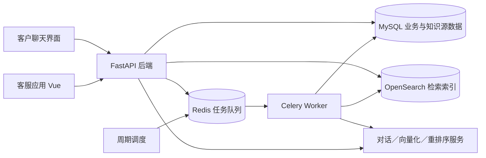
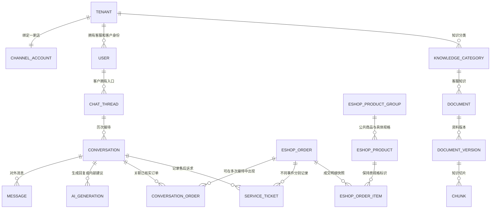
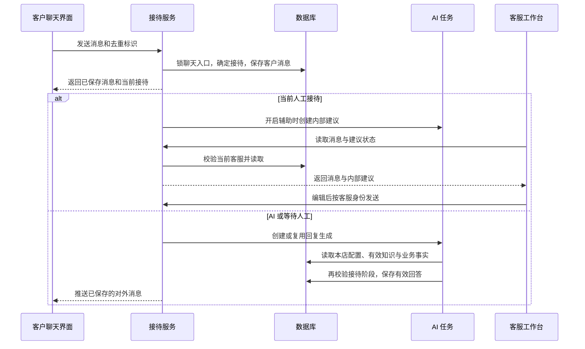

# 第一版后端与前端对接设计（分阶段实施中）

本版已合并截至 2026-10-21 的已确认变更；依据当前[产品定义](./第一版产品定义.md)、[功能清单](./第一版功能清单.md)和[验收标准](./第一版验收标准.md)设计，变更来源见[前端调整确认](./前端调整确认-2026-10-21.md)。

更新日期：2026-10-21。状态：后端基础改造首批已落地并完成联调。已实现店铺与客服身份、有效登录端、稳定聊天入口、消息持久化、人工接入、完结和新建接待、历史查询；实际范围、启动方法及检查结果见[基础改造交付说明](../app/FOUNDATION.md)。五个模块的[内存交互预览](../app/FRONTEND_PREVIEW.md)继续保留；真实数据工作台使用独立数据库和入口。真实模型配置、知识发布、检索、自动回答及调用追踪已进一步接通，见[模型与知识交付](../app/MODELS_KNOWLEDGE.md)；工单、回复辅助及定时接管等仍待后续。

依据：[产品需求](./第一版产品定义.md)、[功能清单](./第一版功能清单.md)、[功能流程](./第一版功能流程.md)、[验收标准](./第一版验收标准.md)、[实施清单](./第一版开发实施清单.md)。已确认的修订线框用于页面布局参考；已确认的前端采用灰白底＋靛蓝主题，当前交互作为接口对接依据。

本文中的“现有”以原工程为对照；正文描述本版完整目标，不代表全部已经实现。下列首批实施范围及[交付说明](../app/FOUNDATION.md)标明实际落地情况，其余表、字段和接口继续按待实施方案理解，不把内存交互当作后端完成。产品行为沿用已确认需求。

## 本轮已实施范围与接口差异

| 范围 | 2026-10-21 实际状态 |
| --- | --- |
| 迁移 | Alembic 基线 `20261021_01`、基础扩展 `20261021_02`、模型与知识扩展 `20261021_03`；独立开发库备份升级，SQLite 与 MySQL 检查通过 |
| 店铺与账号 | 本店统一客服身份、同店共享、跨店隔离、创建／启停客服、在线状态、心跳及新登录端替换旧端；模型配置与 Key 加密已接通，头像后续实现 |
| 聊天与接待 | 新增 chat_thread；客户入口连续保留，conversation 保存每次独立接待；文本消息落库、游标分页、接入、完结、再咨询与人工重开可用 |
| 前端 | 复用已确认工作台，新增 `?mode=live` 与 `?mode=customer&store=qinghe`；客服账号与历史抽屉接真实接口，原五模块演示继续隔离运行 |
| 兼容边界 | 同一后端工程由 FOUNDATION_ENABLED 选择新接口或原接口，只挂一套路由；新模式不挂旧演示、内部签发、旧电商与 WebSocket 接口，防止固定店铺逻辑成为旁路 |
| 未迁移的旧归属 | 不猜测原数据库的多平台账号映射；兼容列暂可空，未映射账号不得启动新模式。旧会话及消息尚未回填 chat_thread；正式迁移需单独核对映射 |
| AI 与计时 | 三类真实模型、Key 校验与加密、知识发布／有效期／检索、自动回答／转人工、召回测试与追踪已接通。开启后新咨询 AI_ACTIVE，关闭后 WAITING_USER；摘要、5 分钟完结、300 秒安抚与 30 秒补位仍待实现 |
| 实际更新方式 | 当前文本消息和列表每 3 秒查询，客服每 10 秒心跳；WebSocket 后续按本设计接通，不宣称当前已实现 |
| 检查 | 本轮 SQLite 24 项、MySQL 8.4 接口 22 项；另有三类模型及浏览器真实链路验证，见[模型与知识说明](../app/MODELS_KNOWLEDGE.md)。基础阶段旧预览副本保留 8 个用户、23 次接待与 239 条消息；前端类型检查和构建通过 |

本阶段接口使用 `detail.code` 和 `detail.message` 返回业务错误，分页默认 25、最多 100；消息通过 `after_id` 连续取数。重开采用请求体 `request_id`＋`expected_epoch`，同键同参数返回原结果；不同时支持另一套 Idempotency-Key 表达。新增 reception_request 保存重开请求摘要及结果，唯一约束为 `(tenant_id,actor_id,scope,request_key)`。客户结束请求绑定 `conversation_id`，迟到请求不会结束后来新建的接待。统一错误 request_id 和本阶段模型追踪已补齐；头像、组合外键及完整分析筛选仍需后续完善。

当前实际后台使用数据库任务与 180 秒租约，由本机后端自动启动线程，重启后可接管过期任务；尚未使用 Celery／Redis 调度。检索使用数据库中绑定模型空间的真实向量、词法候选、RRF 和真实重排，尚未接通 OpenSearch。这些是当前实现边界，正文中的外部队列与 OpenSearch 保留为完整目标。

摘要字段当前为 NONE／空文本，不生成假摘要或 Token。后续接摘要时继续遵守“摘要调用及重试单独追踪，不计入会话 Token 总量，也不影响接待用量完整性”的已确认口径。

## 0. 先看这几项设计结论

| 问题 | 初稿方案 |
| --- | --- |
| 是否重搭工程 | 继续使用 AgentServe，保持一个前端工程和一个模块化后端，复用电商、知识处理及追踪能力 |
| 外部平台是否本版接入 | 暂不接入淘宝消息接收和淘宝订单查询，不实施为此服务的授权／回调／订单同步，也不作为开发或验收前置条件；使用本项目聊天入口和本地电商数据库 |
| 数据存在哪里 | 正式业务结构沿用 MySQL；OpenSearch 保存可重建的检索索引；Redis 与 Celery 执行后台处理和周期检查。SQLite 继续用于独立本地预览，不能代替 MySQL 并发验证 |
| 同一聊天框如何对应多次接待 | 新增稳定的聊天入口，原 conversation 表继续记录每次接待。客户入口不变，内部可以产生新的接待记录 |
| 人工求助是不是工单 | 不是。人工求助通过接待状态及求助轮次表达；客服工单单独按“本次接待＋订单”记录诉求 |
| 多客服和店铺隔离怎样落地 | 店铺归属由认证上下文确定；同店数据共享，回复仍校验当前负责人；数据库约束与业务校验共同防止关联串店 |
| 是否为每类模型新建 models 表 | 不建模型目录表。三个模型角色继续复用配置版本，服务商及适配能力由平台代码维护，密钥加密保存 |
| 前端如何更新 | 命令和查询走 HTTP；消息复用 WebSocket；列表和生成状态采用短周期查询。第一版不另建完整事件总线 |
| AI 如何决定下一步 | 模型理解诉求并给结构化建议，程序校验身份、订单和允许操作，再调用已有服务；不整体改成自由循环 ReAct |
| 工单是否执行业务 | 不执行。保存、修改、标记完成均不调用退款、物流或库存写入逻辑 |
| 商品与规格怎样拆 | 新增商品公共信息表，原 eshop_product 继续作为具体规格，保留其 ID、SKU、价格和库存；订单与流水不改挂到公共商品上 |
| 一句话摘要怎样生成 | 接待完结后创建后台任务，独立保存文本和生成状态；任务失败不回滚完结，不用首条消息充当摘要 |
| 图片怎样保存 | 商品图片、客服头像使用店铺媒体资料；客户聊天图片继续使用关联聊天入口的附件，两者不混用归属 |

推荐阅读顺序：先看第 2 节的数据关系、第 4 节的状态、第 7 节的数据流，再查表结构和接口。实现顺序见第 11 节。

## 1. 工程结构与复用边界

### 1.1 运行结构

Redis、Celery 已在上游依赖中，原先主要用于可选文档处理。本设计将它们用于回复生成、知识发布和定时检查；完整运行环境需要启动 Worker 与周期调度。消息是否保存、谁接入、工单是否完成均以数据库为准，不以队列或浏览器内存为准。

### 1.2 后端职责

| 层次 | 职责 | 复用与调整 |
| --- | --- | --- |
| API | 接收参数、鉴权、调用服务、返回结果 | 保留原 API 分组；增加工单和接待端接口，收敛店铺范围 |
| 业务服务 | 接待状态、工单、知识发布、配置及电商规则 | 扩展现有 services；AI 编排和电商处理分开 |
| 模型与业务适配 | 调用已适配模型、读业务事实、执行允许的业务动作 | 复用 providers；改为显式传入本店配置，不再取其他店或全局 Key 兜底 |
| 后台任务 | 慢调用、知识处理、超时检查与失败恢复 | 扩展 tasks；任务只携带内部 ID，执行时重新读取归属与状态 |
| 数据与追踪 | 源数据、版本、调用过程、操作依据 | 扩展现有 models 与 tracing；不把追踪日志当作订单处理结果 |

后续可新增 `services/tickets.py`、`services/reception.py`、`services/model_config.py` 等职责文件；这是建议的代码组织，不是已经创建的文件。前端继续使用 Vue、Pinia 和 Element Plus。

### 1.3 本版外部接入边界

用户已确认本版先不接入淘宝消息接收和淘宝订单查询。本版不实现这两项所需的淘宝授权、消息订阅／回调、远程订单拉取及增量同步，不申请或存储相应平台凭据，也不把平台准入验证作为本轮开工条件。平台标识和一家店铺的归属仍保留，未来接入可在此基础上扩展。

客户消息由本项目客户聊天入口经 HTTP／WebSocket 进入服务端；订单、商品、库存、物流和退款事实由本地电商数据库及现有业务服务提供。数据可从演示初始化开始，但正式改造后的记录应持久化，不能用浏览器内存代替。AI 的业务查询走这一数据源，不为本版新增淘宝请求。

模型服务和业务数据源分别配置：业务使用本地数据库，不要求对话、向量化及重排也采用模拟模式；后续真实模型、知识检索和回复辅助仍属于本版实施内容。现有电商 API 的运行模式限制应按此边界适配，不以淘宝未授权拒绝本地业务。

### 1.4 本次核对出的关键差异

- 认证、游客身份及 WebSocket 等路径仍有固定 `tenant_id=1`；不能只去掉登录限制就认为多租户已完成。
- channel_account 当前没有 tenant_id，高权限账号可看到多个平台账号；需改为一个店铺的唯一绑定。
- conversation 有 AI_ACTIVE、WAITING_USER、HUMAN_ACTIVE、CLOSED，但完结后拒绝新消息，等待和人工状态不继续调用 AI。
- PendingAction 表示需要客户确认的业务动作，不具备本版客服工单语义。
- 原版模型名称可配置，调用凭据主要来自服务器设置；原 OpenSearch 向量使用统一索引，不能直接承载任意不同维度的店铺配置。
- 原知识恢复接口允许选历史版本，并重设生效时间、清空失效时间；本版需要调整。
- 原前端通过菜单 key 切换页面，没有引入独立页面路由库；原电商接口还有运行模式与多角色限制，需与本版入口一起适配。

源码依据集中列于文末，避免在每个字段旁重复引用。

## 2. 数据关系：聊天、接待和工单分别是什么

### 2.1 三个概念

**聊天入口 chat_thread**：某店铺中某客户的长期聊天入口。客户持续使用这一个入口，不必理解内部是否换了一次接待。

**接待记录 conversation**：一次可以完结的服务过程。可以从 AI 开始，中间等待人工、由人工接入，最后完结。它也是本版人工事件和工单归属的主要边界。

**客服工单 service_ticket**：这次接待针对某一订单的售后诉求记录。一个接待可以有多张工单，同一订单在本次接待里可以记多种诉求，但只生成一张记录。

图只展示主要关系。客服和客户继续使用 user 表中的不同身份类型；“只有客服角色”指店铺工作人员，不是把客户身份改成客服。平台内部开通租户不增加店铺端管理员或运营角色。

### 2.2 接待重开的映射

| 操作 | 数据变化 |
| --- | --- |
| 客户首次打开聊天或咨询 | 找到或创建 chat_thread，并创建接待；自动接待开启时 AI_ACTIVE，关闭时 WAITING_USER。已有已完结接待仅刷新入口时不新建；仅打开及欢迎语不算有效提问 |
| 当前仍有人接待时客户发消息 | 使用当前 conversation，不换接待人 |
| 完结后客户再次发消息 | 在原聊天入口下创建新接待；自动接待开启时 AI_ACTIVE，关闭时 WAITING_USER |
| 客服点击重新发起（固定新建） | 原入口下创建新的 HUMAN_ACTIVE 接待记录，由发起客服负责 |

一个聊天入口最多有一条当前未完结接待。若已有新的接待在进行，不允许再把旧记录重开成第二条活动接待，返回状态冲突并进入当前接待。重新发起统一使用新记录，工单不会错误合并；服务端按客户入口聚合和分页，不能只在前端对接待列表去重。原聊天中由接待元数据呈现分割线；不把分割线伪装为客户或 AI 新消息。

旧记录保持已完结，新记录作为新一次接待独立统计。聊天入口数量和接待记录数量分别计算，不能因为联系人合并就合并接待统计。

## 3. 数据表设计

### 3.1 统一约定

- 下表是逻辑字段设计，正式迁移时与现有字段对齐。未列出的原字段继续保留，不代表删除。
- 新增主键及关联主键使用整数，和原有表保持类型一致；业务编号与内部主键分开，接口中的 `order_pk` 指 eshop_order.id，展示订单号指 order_id 字符串。
- 时间在服务端统一按 UTC 保存，接口输出带时区时间，页面按本地时区显示。可空时间用 NULL，不用空字符串。
- 新增业务记录带 created_at、updated_at；可编辑记录带 revision，初始 1，用于识别别人已经修改的情况。
- 店铺范围从认证用户推导，不接受请求体任意指定 tenant_id。联表对象也要校验同店，不能只判断顶层记录。
- 对有 tenant_id 的父表补充唯一键 `(tenant_id,id)`；子表通过相同 tenant_id 的组合外键绑定，或经明确的父关系传递归属。有关联冗余字段时，服务在同一事务内核验客户、接待及订单三者关系。
- MySQL 是约束和并发行为的验收环境。SQLite 预览不声称具有相同行锁能力。

### 3.2 现有表扩展：店铺、账号和配置

| 表 | 字段及类型 | 空值／默认 | 用途与约束 |
| --- | --- | --- | --- |
| tenant | active BOOLEAN | 非空，true | 平台内部控制租户可用性；不增加店铺自助运营页面 |
| channel_account | tenant_id INT FK | 新模式必须有值；兼容旧记录暂可空，待映射回填 | UNIQUE(tenant_id)，保证一租户一家店；平台及外部店铺编号沿用原字段 |
| channel_account | entry_code VARCHAR(32) | 新模式必须有值；兼容旧记录暂可空 | 唯一公开入口标识，仅定位店铺，不作为读取客户资料的凭据 |
| user | session_id VARCHAR(36) | 可空 | 当前有效客服接待端标识，登录成功后重新生成 |
| user | session_version INT | 非空，0 | 新端登录、注销或停用时递增，使旧令牌失效 |
| user | work_status VARCHAR(16) | 非空，OFFLINE | ONLINE／OFFLINE，手动状态，只影响新接入 |
| user | last_heartbeat_at DATETIME | 可空 | 当前有效接待端最近心跳；不能由旧端刷新 |
| user | avatar_asset_id VARCHAR(36) FK | 可空 | 本店客服头像，引用第 3.10 节媒体资料，不直接接收任意文件路径或其他店铺资源 |
| prompt_template | revision INT | 非空，1 | 业务模板编辑并发检查，保留原全文和更新时间 |

user 的账号名、邮箱暂时继续使用原有全局唯一约束，登录无需增加店铺选择。不同店铺使用不同账号。店铺工作人员统一为 CUSTOMER_SERVICE，店铺 API 使用统一客服身份检查，去除旧多角色及 SUPER_ADMIN 通配访问假设；身份归属校验仍保留。

staff_account_access 只用于迁移兼容，运行时不再靠它拼出多个可选店铺；external_customer_identity 继续绑定所属 channel_account，不能回退到固定 account_id=1。游客入口由 entry_code 定位有效店铺，创建本店独立游客身份；恢复身份还需校验原访客凭据及店铺。公开入口码本身不能读取其他客户聊天。内部客户令牌签发也必须从已验证的账号绑定推导店铺，不接受任意 tenant_id。

配置继续保存到 config_version，不新增模型目录表。将 model、rag 及接待配置分别按 kind 管理；后端一次提交即进入生效流程，不要求前端先保存草稿再发布。编辑携带 expected_version，后端核对当前活动版本后再分配新版本号，不能只比较每行都相同的初始 revision。

| 配置内容 | value 中的建议字段 | 说明 |
| --- | --- | --- |
| 三类模型 | dialogue／embedding／rerank 各含 provider、model_id、key_ciphertext、key_fingerprint、verified_fingerprint；embedding 另有 dimension | Key 可相同或不同，分别加密；指纹用于判断验证结果是否仍对应当前配置，不是 Key 明文 |
| 检索 | final_top_k、min_score | 默认 Top K=5，范围沿用原 1～10；Score 必填，默认 0.30，范围 0～1 |
| 接待 | reception_enabled、greeting_enabled、greeting_text | 整店接待与欢迎语独立；新店 greeting_enabled 默认 false，既有明确设置不重置；固定时长只读 |

检索接口把 Score 声明为必填有限数值，允许 0 和 1，拒绝缺失、null、空字符串、布尔值、非数值、NaN、Infinity 及越界；Top K 为 1–10 的整数，拒绝布尔值或小数冒充整数。0.30 与 5 只用于首次初始化／读取旧配置缺项，不在保存失败时悄悄填回以绕过必填校验。错误返回可定位字段，由前端放在输入框旁。

密钥使用成熟认证加密实现，主密钥由部署环境注入，不存入同一配置或代码仓库。返回配置只给 `has_key`、遮挡提示和验证情况；新建缺失 Key 不可用，编辑省略或留空表示保留原 Key，不接受把遮挡字符串当作新 Key。调用追踪和缓存键也不得含明文 Key。

每次调用使用显式的店铺配置快照，含 provider、模型、配置版本和服务端解密凭据。服务地址来自平台适配清单，不允许前端传入任意 URL；缓存至少以 tenant_id、配置版本和模型角色区分。配置验证结果由服务端保存或签名，并与实际验证的配置指纹绑定，保存接口不接受客户端自报“已经验证”。

### 3.3 新增 chat_thread：稳定聊天入口

| 字段 | 类型 | 空值／默认 | 说明 |
| --- | --- | --- | --- |
| id | INT PK | 自动生成 | 聊天入口编号 |
| tenant_id、account_id、customer_id | INT FK | 非空 | 绑定店铺及客户，customer_id 指 user.id |
| active_conversation_id | INT 指针 | 可空 | 当前未完结接待，由同一事务校验归属；首次打开可创建接待，已完结后刷新只读取原记录 |
| last_message_id、last_message_at | INT 指针／DATETIME | 可空 | 本入口最近一条对外消息及时间，支持按客户入口排序；工单和摘要更新不刷新 |
| revision | INT | 非空，1 | 并发修改版本 |
| created_at、updated_at | DATETIME | 非空，当前时间 | 记录时间 |

约束：UNIQUE(tenant_id,account_id,customer_id)。创建接待、完结、重开和客户发送消息时先锁定该入口，再检查或更新当前接待指针，保证同一客户不会同时创建两条活动接待。active_conversation_id 必须属于当前入口，这项由事务服务校验。增加 `(tenant_id,last_message_at,id)` 查询索引；没有活动接待时返回最近一条接待的状态与编号。列表 total 按聊天入口计算，历史和统计仍按接待记录计算。

### 3.4 扩展 conversation：接待状态和计时依据

| 字段 | 类型 | 空值／默认 | 说明 |
| --- | --- | --- | --- |
| thread_id | INT FK | 新记录非空，旧记录暂可空、待回填 | 所属聊天入口 |
| revision、reception_epoch | INT | 非空，1 | revision 表示资料变化；epoch 在接待人或阶段改变时递增，作废旧生成结果 |
| last_customer_message_at | DATETIME | 可空 | 5 分钟计时依据，欢迎语和 AI 回复不刷新 |
| last_answered_customer_message_id | INT FK | 可空 | 已完成回复的客户消息，避免未回答就自动完结 |
| handoff_round | INT | 非空，0 | 每次新人工求助递增；等待期间重复求助不递增 |
| handoff_requested_at、comfort_sent_at | DATETIME | 可空 | 本轮等待起点及一次安抚记录 |
| ever_handoff_requested、ever_human_claimed | BOOLEAN | 非空，false | 历史事实只能从 false 变 true，用于统计；接待状态切回 AI 不能清除 |
| history_facts_complete | BOOLEAN | 非空，true | 新接待为 true；迁移历史无法核实人工事实时设 false，不能据此声称 AI 独立接待 |
| last_agent_id | INT FK | 可空 | 断线补位后识别可明确接回的原客服 |
| assist_enabled | BOOLEAN | 非空，true | 单会话辅助开关；重开或换接待端重新初始化，不恢复旧草稿 |
| active_assist_id | VARCHAR(36) FK | 可空 | 当前有效内部建议任务 |
| close_reason | VARCHAR(32) | 可空 | 人工完结、AI 空闲、客户结束等；原 closed_at 继续保留 |
| consultation_summary | TEXT | 可空 | 本次已完结接待的一句话咨询摘要，不是首条消息或跨接待客户画像 |
| summary_status | VARCHAR(16) | 非空，NONE | NONE／PENDING／RUNNING／READY／FAILED／SKIPPED，分别表达未请求、等待、生成、就绪、失败和无有效内容 |
| summary_generation_id、summary_source_message_id | VARCHAR(36) FK／INT FK | 可空 | 当前摘要任务和生成时该接待消息上界，防止重试旧结果覆盖 |
| summary_generated_at | DATETIME | 可空 | 只有有效摘要落库时填写 |

原 status、current_agent_id、handoff_reason、started_at、last_message_at 保留。last_message_at 只在出现对外消息时变化；完结、工单更新不改变其排序时间。

索引：`(tenant_id,status,last_message_at,id)` 用于工作台；`(tenant_id,user_id,started_at,id)` 用于历史；等待和空闲检查分别使用 `(status,handoff_requested_at)`、`(status,last_customer_message_at)`。所有时间任务仍需重新判断资格。

人工请求及接入事件写入现有 audit_log，detail 含 conversation_id、handoff_round、agent_id 和事件时间；同一次等待请求只记一次。人工求助不另建一张客服工单表或一套派单表。

### 3.5 消息、图片与内部生成结果

| 表 | 新增／调整字段 | 用途 |
| --- | --- | --- |
| message | tenant_id INT、sender_user_id INT 可空 | 消息店铺归属及真实发送客服；原 sender_type 继续区分 CUSTOMER／AI／AGENT／SYSTEM |
| message | thread_id INT FK 非空 | 所属稳定入口，必须与 conversation 的入口一致 |
| message | client_message_id VARCHAR(64) 可空、dedupe_key VARCHAR(128) 可空 | 客户端去重唯一键为 tenant_id、thread_id、sender_user_id、client_message_id；系统去重唯一键为 tenant_id、conversation_id、dedupe_key |
| message | payload JSON 可空、origin_generation_id VARCHAR(36) 可空 | 保存图片附件引用、商品／订单卡片及建议来源；content 仍供文字展示 |
| message | delivery_status | 沿用并补齐语义：已保存与实际投递分开，失败不能表示送达 |

message 增加 `(tenant_id,conversation_id,id)` 索引。一次消息只能有一个确定发送者；内部建议不写成 AI 消息后再隐藏，避免误发给客户。

**新增 attachment，保存图片归属和文件信息：**

| 字段 | 类型 | 空值／默认 | 说明 |
| --- | --- | --- | --- |
| id | VARCHAR(36) PK | 服务端生成 | 附件编号 |
| tenant_id、thread_id、uploader_user_id | INT FK | 非空 | 归属及上传者 |
| storage_key | VARCHAR(512) | 非空 | 服务端文件位置，不接受任意外部 URL |
| mime_type、byte_size、sha256 | VARCHAR(64)／INT／VARCHAR(64) | 非空 | 实际检测的文件类型、大小与校验 |
| message_id | INT FK | 可空 | 发出消息后绑定；未绑定文件按临时文件清理 |
| created_at | DATETIME | 非空，当前时间 | 上传时间 |

商品图片与客服头像没有聊天归属，使用第 3.10 节媒体资料，不能为了上传而创建假 thread。聊天附件仅支持适配的图片类型，文件名不决定类型，访问也校验店铺和客户。图片先展示给客服；若当前对话模型没有图片理解能力，不宣称自动识图成功，继续请客户说明或转人工，不新增第四类必配模型。

**新增 ai_generation，保存正式回复和内部建议的执行状态：**

| 字段 | 类型 | 空值／默认 | 说明 |
| --- | --- | --- | --- |
| id | VARCHAR(36) PK | 服务端生成 | 任务标识，也用于取消和防重复 |
| tenant_id、conversation_id | INT FK | 非空 | 所属接待 |
| mode | VARCHAR(16) | 非空 | REPLY／ASSIST／COMFORT／SUMMARY；SUMMARY 为完结后摘要，不是对客回复 |
| source_message_id | INT FK | 可空 | REPLY／ASSIST 关联客户消息，SUMMARY 记录本次消息上界；安抚可空 |
| owner_user_id、owner_session_id | INT／VARCHAR(36) | 可空 | ASSIST 必填，限制建议所属接待端 |
| reception_epoch | INT | 非空 | 启动时的接待阶段版本 |
| attempt_version | INT | 非空，0 | 每次领取递增，旧 Worker 租约到期后不能再提交有效结果 |
| status | VARCHAR(16) | 非空，QUEUED | QUEUED／RUNNING／READY／CANCELLED／FAILED／STALE |
| output_text、error_code | TEXT／VARCHAR(64) | 可空 | 结果及安全错误码，不保存请求凭据 |
| trace_id | VARCHAR(64) FK | 可空 | 对应调用追踪 |
| dedupe_key | VARCHAR(128) | 非空 | UNIQUE(tenant_id,dedupe_key) |
| lease_until、created_at、finished_at | DATETIME | 租约及结束可空；创建非空默认当前时间 | 任务领取、创建及结束时间 |

索引：`(tenant_id,conversation_id,mode,created_at)`、`(status,lease_until)`。REPLY 就绪后在同一事务中校验阶段并保存唯一 AI 消息；ASSIST 就绪只供当前客服读取，不自动创建客户消息。取消任务不能保证供应商立即停止计算，但能保证旧结果不再写入输入框或发送。SUMMARY 独立按 CLOSED、消息上界和当前摘要任务核验，不套用“接待已关闭即丢弃”的对外回复规则，不写 message 或触发工单。

### 3.6 新增 conversation_order：本次核实过的订单

字段：id INT PK、tenant_id INT FK、conversation_id INT FK、order_pk INT FK、source_message_id INT 可空、created_at DATETIME。除可空标注外均必填，时间默认当前时间。

约束：UNIQUE(tenant_id,conversation_id,order_pk)。只有核实属于当前客户、当前店铺的订单才能关联；AI 提取到字符串不代表核实通过。用于会话右侧展示及待办创建时的订单选项，不把客户所有订单自动当作本次关联。

### 3.7 新增 service_ticket：轻量客服工单

| 字段 | 类型 | 空值／默认 | 说明 |
| --- | --- | --- | --- |
| id、ticket_no | INT PK／VARCHAR(64) | 非空，服务端生成 | 内部主键及展示编号，ticket_no 唯一 |
| tenant_id、conversation_id、customer_id、order_pk | INT FK | 非空 | 创建后不能修改的四项归属 |
| source | VARCHAR(16) | 非空 | AI／MANUAL |
| created_by_user_id | INT FK | 可空 | 手动创建时填客服，AI 创建为空 |
| source_message_id、source_trace_id | INT／VARCHAR(64) | 可空 | 自动建单依据，可追溯到明确诉求 |
| request_types | JSON 字符串数组 | 非空 | 七类类型，可多选，去重并校验枚举 |
| requests | JSON 数组 | 非空 | 商品、数量、诉求类型、请求金额、新地址或换货目标及说明；记录用，不是执行命令 |
| summary | TEXT | 非空 | 大白话说明主要诉求 |
| completion | VARCHAR(16) | 非空，PENDING | 仅 PENDING／DONE，对应待完成／已完成 |
| completed_by_user_id、completed_at | INT FK／DATETIME | 可空 | 只有人工标记后填写，二者同时为空或同时有值 |
| revision、created_at、updated_at | INT／DATETIME／DATETIME | 非空，1／当前时间／当前时间 | 编辑并发及时间 |

约束：UNIQUE(tenant_id,conversation_id,order_pk)。同事件同订单自动或手动重复创建均返回已有记录；新的售后事件使用新的 conversation。完成后的内容补充仍保留 DONE，不自动重开。

索引：`(tenant_id,completion,created_at,id)`、`(tenant_id,customer_id,created_at)`、`(tenant_id,order_pk,created_at)`；类型筛选先按本店候选记录及 JSON 包含查询，不提前拆出执行任务表。

类型编码：CANCEL_ORDER、REFUND_ONLY、RETURN_REFUND、EXCHANGE、CHANGE_ADDRESS、RESEND、OTHER。部分退款写入金额和明细，不增加类型。

requests 中金额使用十进制字符串；商品项如提供 order_item_id，必须属于该订单。允许同一订单多个商品不同诉求。校验格式及归属，不把记录保存当作业务资格审批，不调用业务写接口。修改采用 expected_revision，冲突时返回 409，不覆盖别人刚保存的内容。

### 3.8 知识分类、文档与版本

**新增 knowledge_category：** id INT PK、tenant_id INT FK、name VARCHAR(100)、description TEXT 默认空、created_by_user_id INT FK、updated_by_user_id INT FK、revision INT 默认 1、created_at／updated_at DATETIME。全部非空，时间默认当前时间；UNIQUE(tenant_id,name)。有文档关联的分类不可直接删除。

| 现有表 | 扩展字段 | 用途与规则 |
| --- | --- | --- |
| document | category_id INT FK 非空、revision INT 默认 1 | 对应知识库分类；分类与文档同店 |
| document | previous_published_version_id INT 可空 | 只开放恢复上一已发布版本；current_version_id 表示最近一次发布的版本，实际可用版本由有效时间选择 |
| document_version | purpose TEXT 默认空、summary_status VARCHAR(16) 默认 PENDING | 本版本用途说明及生成情况；已有版本可修正用途，新建页隐藏该字段 |
| document_version | split_separator VARCHAR(128) 可空、chunk_length INT 默认 500、overlap_length INT 默认 50 | 每篇每版分段参数；迁移优先保留已使用的设置 |
| document_version | embedding_profile VARCHAR(128) 可空、embedding_dim INT 可空 | 向量绑定的服务商、模型及维度配置指纹 |
| document_version | source_version_id INT 可空 | 恢复、编辑已发布切片时记录来源，保留原引用 |
| chunk | embedding_profile VARCHAR(128) 可空 | 对应生成该切片向量的配置，检索时不能混用不同模型空间 |

本轮正文入口只接受每次一个、不超过 2 MB 的 UTF-8 纯文本文件：md、markdown、txt、csv、tsv、json、yaml、yml、xml、log，按正文读取，不增加结构化数据导入语义。服务端同时检查扩展名、实际字节、编码、NUL 等无效内容与大小，不接受 PDF／Word、URL 抓取或压缩包；旧版上传接口同样执行该边界。允许不上传文件而直接提交正文。

分段长度技术范围与现有前端对齐为 100–4000，重叠长度为不小于 0 且小于分段长度的整数；新建默认 500／50，迁移保留已发布版本的真实参数。日期支持显式 null 清空，不以空字符串持久化；失效时间早于生效时间返回字段错误，不增加必填日期。

原文、版本号、切片、tags 和生效／失效时间继续复用。auto_revert_on_expiry 固定 false，前台不开放。资料版本 PROCESSING／FAILED 等是后台发布处理状态，不代表新增“保存草稿”产品功能。

新内容在向量化及索引准备成功后才进入发布版本集合。已经发布的切片编辑先复制为候选版本，再重算，不原地破坏旧切片，保证失败时原内容仍可使用，也保证历史引用不会变成另一段文字。

发布顺序决定替代关系；在已到生效时间的发布记录中选择最近一次发布，若该版已到期则停止使用，不回找更旧内容。未来生效的新版本未到时间前，原有效版本仍可使用。恢复上一版通过新发布记录引用／复制上一版内容，并保留其原日期；恢复内容已经过期时仍不可作为当前知识。

### 3.9 追踪与电商结果记录

- question_trace 扩展 generation_id 可空；kind 明确区分 question、assist、comfort、summary、recall_test、ingestion、config_check。conversation_id、user_id 允许按类型为空，但 question／assist／comfort／summary 必须有关联接待，所有类型必须有 tenant_id。
- question_trace_node 的 conversation_id 对独立测试及知识处理可空。已有 usage JSON 继续复用，服务统一解析输入、输出及总 Token，同时保留“供应商未报告”状态，不新增账单表。
- feedback 增加 created_at、updated_at DATETIME；新评价写入真实时间，旧记录无法回填时允许为空，不拿消息发送时间假装评价时间。归属通过 message 和 conversation 核对。
- pending_action 增加 tenant_id、order_pk 归属与关联检查，继续作为取消订单／申请退款的客户确认动作，不和工单合并。
- eshop_operation 增加 tenant_id、account_id、order_pk、conversation_id 可空、trace_id 可空、source、status、finished_at。source 区分 AI_CONFIRM 和 MANUAL；status 包含 EXECUTING／SUCCESS／FAILED／UNCERTAIN。原 idempotency_key 和 response 保留，作为同一实际写操作的稳定标识。
- 现有电商支付、物流、退款、库存表通过所属订单／商品校验店铺，不机械地给每张表重复增加 tenant_id；不得通过单独的退款编号绕过父订单归属。

业务操作记录保留 AI 确认和人工操作来源，默认按已确认需求统计纳入口径的实际业务写入，不在初稿中缩窄为仅 AI 操作。页面说明具体纳入的 action 清单；查询、工单完成及确认前取消不纳入，不沿用原包含查询的工具成功率。若后续需要单看 AI 执行效果，可按来源筛选，不改变底层记录含义。

### 3.10 新增 media_asset：商品图片与客服头像

这是店铺资料文件，与第 3.5 节客户聊天附件分别管理；可复用文件存储、哈希和类型检测函数，不能复用必须绑定 thread 的业务归属。

| 字段 | 类型／默认 | 用途与约束 |
| --- | --- | --- |
| id | VARCHAR(36) PK，服务端生成 | 媒体资源标识 |
| tenant_id、uploaded_by_user_id | INT FK，非空 | 所属店铺及上传客服 |
| purpose | VARCHAR(24)，非空 | PRODUCT_IMAGE／STAFF_AVATAR |
| storage_key、mime_type、byte_size、sha256 | VARCHAR(512)／VARCHAR(64)／INT／VARCHAR(64)，非空 | 后端检测后的文件信息，不接收任意服务器路径 |
| status、created_at | VARCHAR(16) 默认 TEMP／DATETIME 默认当前时间 | TEMP／BOUND；未绑定临时文件到期清理 |

PRODUCT_IMAGE 限 JPG／PNG／WebP、5 MB，STAFF_AVATAR 限相同类型、2 MB；校验实际内容而非只看后缀。保存商品或客服资料时核验店铺、用途和绑定关系，在业务事务中绑定资源；失败不覆盖旧图。文件读取沿业务可见范围鉴权，资源 ID 不自动代表读取许可。图片字段只保存资源标识，不把浏览器临时地址或完整 base64 写入业务记录。

### 3.11 商品公共信息、规格与客户备注

**拆分目的：** 原 eshop_product 已被订单明细和库存流水引用，而且本身有 SKU、价格及两类库存。保留这张表作为 SKU（具体规格），新增公共商品信息，减少重建旧交易引用的风险。SPU 在本文只表示公共商品层，不新增商品运营功能。

| 表／字段 | 类型／默认 | 用途与约束 |
| --- | --- | --- |
| 新增 eshop_product_group | id INT PK、tenant_id／account_id INT FK、name VARCHAR(255)、image_asset_id VARCHAR(36) FK 可空、description TEXT 默认空、revision INT 默认 1、created_at／updated_at DATETIME | 公共名称、图片及原有描述；同店关联，不以商品名称唯一来合并记录 |
| eshop_product.group_id | INT FK，迁移完成后非空 | 归属公共商品，父子必须同店 |
| eshop_product.variant_name | VARCHAR(128)，非空 | 新建规格必填；去除首尾空白后同商品不重名，数据库约束与业务比较保持一致 |
| eshop_product.revision | INT，默认 1 | 编辑规格资料的并发检查；库存仍走专用操作 |
| eshop_order_item.variant_name | VARCHAR(128)，可空 | 下单时规格文案快照；原有 sku、name、unit_price、quantity 继续保存成交事实 |
| eshop_customer.remark | TEXT，非空默认空 | 客服手动填写，全店共享；AI、摘要及外部档案刷新不得覆盖 |
| eshop_customer.revision、updated_by_user_id、updated_at | INT 默认 1／INT FK 可空／DATETIME | 资料及备注修改版本、操作人和时间；历史操作人未知保持空 |

新增 UNIQUE(group_id,variant_name)，原 account_id＋sku 唯一约束保留；增加 `(tenant_id,group_id,created_at,id)` 索引。同一批创建时以服务端生成的创建顺序及 ID 确定首个规格，列表 reference_price／first_variant_id 按 `(created_at,id)` 最早一条稳定返回；不按最低价、当前库存或页面排序改选。金额继续使用 Decimal／Numeric，不用浮点计算成交金额。

公共列表一件商品一行，返回规格数、首规格售价和各规格详情入口；在售状态按是否仍有在售规格派生，整件上架／下架在一个事务内更新全部规格，单规格仍可独立维护。库存汇总由规格累加，仅用于展示。可用库存仍对应原 inventory，预占仍对应 reserved，不能把二者合成可销售库存。下单锁具体 eshop_product 并调用原库存服务，取消、发货、退款与人工调整都更新原规格。

商品名称和图片以公共层为准，原规格 name 等兼容字段可在统一服务中同步，不允许两套入口分别修改造成分歧。订单成交名称、规格、单价不随资料编辑回写；已有订单或流水引用的规格不物理删除。公共商品 ID 不可作为旧 product_id 接口的规格 ID。

整件商品及全部规格、初始入库流水在同一事务创建；先校验至少一个规格、去空白后名称不重、正数价格及非负整数库存。任意一行失败则整体回滚，重复幂等请求返回同一商品，不能留下只保存名称或部分规格的记录。已保存规格的库存调整必须走专用库存接口，普通资料 PATCH 不接受直接覆盖库存。

本版客户由合法的本地客户入口、既有数据或演示初始化建立；平台同步留待后续。店铺客服不开放人工新增客户；资料编辑不接收任意 user_id、username 或创建凭据。备注与姓名、电话、档案地址一并读取，修改档案地址不回写已有订单收货快照。

## 4. 接待、生成及工单的状态

### 4.1 接待状态沿用原枚举

| 当前状态 | 事件 | 下一状态与处理 |
| --- | --- | --- |
| AI_ACTIVE | 需要人工 | WAITING_USER；创建本轮等待，ever_handoff_requested=true |
| WAITING_USER | 客户继续询问 | 状态不变；AI 可回答有依据内容，不重复人工请求 |
| WAITING_USER | 在线有效客服成功接入 | HUMAN_ACTIVE；原子设置负责人，ever_human_claimed=true，作废旧对外生成任务 |
| HUMAN_ACTIVE | 客户继续询问 | 状态不变；仅为当前客服生成内部建议 |
| HUMAN_ACTIVE | 客服手动离线 | 状态不变；已有接待仍可回复 |
| HUMAN_ACTIVE | 当前接待端失联超过 30 秒 | AI_ACTIVE；清空当前负责人，保留 last_agent_id 和历史人工事实，由 AI 补位 |
| AI_ACTIVE | 原客服明确接回断线接待 | HUMAN_ACTIVE；校验 last_agent_id、当前无其他负责人及有效在线资格 |
| HUMAN_ACTIVE | 当前客服确认完结 | CLOSED；核验确认目标及 epoch，作废对外任务与建议，创建摘要任务，不自动完成工单 |
| AI_ACTIVE | 已回答、无等待且空闲 5 分钟 | CLOSED；系统轻提示，不把提示当作新客户消息 |
| 任一未完结状态 | 客户明确结束 | CLOSED；停止未完成自动回复及内部建议，保留记录 |
| CLOSED | 客户新消息 | 原记录保持关闭，入口创建新的 AI_ACTIVE 接待 |

WAITING_USER 是原代码名称，页面统一叫“等待人工”，不要误显示为等待客户。已进入等待即使后来 AI 回答了部分问题，也保留本轮等待，不擅自撤销人工请求。

接入、完结、断线补位和重开使用条件更新或行锁；以实际更新行数判断成功。任何店铺客服可看共享资料，只有 current_agent_id 对应的有效客服可回复或完结。人工接待本身没有空闲自动完结。前端确认弹窗保存明确的 conversation_id 和 expected_epoch，取消不发完结请求，确认不读取可能已经切换的当前客户来替换目标；状态冲突时不误关其他接待。所有合法完结路径都统一触发本次摘要准备，模型失败不影响 CLOSED。

### 4.2 辅助生成和前端输入

生成开始时绑定 conversation_id、source_message_id、reception_epoch、owner_session_id 和 generation_id。前端同时记录本地 draft_revision。

- QUEUED／RUNNING：输入框只读，显示生成提示，“关闭 AI”始终可用。
- READY：只有当前任务、当前接待端、当前接待阶段及草稿版本仍匹配，才将文字写入输入框，然后允许修改、清空、发送。
- 关闭：服务端取消当前任务并更新辅助状态；浏览器立即恢复编辑，保留已经展示的文字，迟到结果被忽略。
- 失败：恢复编辑并保留已有文字；显示可理解的错误，不要求重新登录。
- 重开辅助：创建新 generation_id，使用当前上下文重新生成，不复用旧任务。

新客户消息到达时，如果已有一次内部建议正在生成，第一版不增加复杂的自动打断、合并或强制重生成交互。结果保留其对应提问，客服可关闭后再打开重新生成。对外 AI 回复则按接待顺序处理最新有效消息，过时结果不能越过人工接入继续发送。

### 4.3 工单只有两个完成标记

PENDING → 人工标记 → DONE。重复标记返回同一完成结果，不重复更换完成客服和时间。编辑诉求不改变 completion；AI 不将 DONE 改回 PENDING，也不从电商退款状态推导 completion。

## 5. 后端 API 路由设计

这是完整目标的接口契约，列出页面需要的输入输出及主要约束。新模式已实施部分由 FastAPI 自动提供 OpenAPI，其余接口尚未实现。原有 `/api/admin` 前缀保留以减少迁移；它在本版不表示店铺有“管理员角色”。

### 5.1 通用约定

- 身份从有效令牌获取 tenant_id、user_id、kind；客服另校验 session_id、session_version。请求体传入跨店或不归属对象时拒绝。
- 列表统一 page、page_size、keyword，返回 items、total、page、page_size；限制每页数量，不能沿用固定 limit 导致后续记录永远看不到。
- 编辑传 expected_revision；重复写提交传 Idempotency-Key 或 client_message_id，服务端同时检查参数摘要，不能把同一标识用于不同操作。
- 成功优先保留原结构并补字段。错误统一含 code、message、request_id、可选 current_revision；401 身份失效，403 操作人不符，404 不存在或跨店不可见，409 并发／状态冲突，422 参数错误，503 依赖不可用。
- 慢任务返回 202 和任务标识；客户端断开不等于业务取消。取消必须走明确的取消接口。

### 5.2 身份与平台设置

| 方法及路径 | 来源 | 主要输入 → 返回 | 关键限制 |
| --- | --- | --- | --- |
| POST /api/auth/login | 调整 | 账号、密码 → token、当前身份、店铺摘要 | 账号确定店铺；客服新 sid/version 原子替换旧端 |
| GET /api/auth/me | 调整 | 有效 token → 身份、店铺、工作状态 | 不返回其他店铺的可选列表 |
| POST /api/auth/logout | 新增 | 当前 token → 成功 | 仅注销当前有效 sid，不允许旧端注销新端 |
| POST /api/agent/heartbeat | 新增 | 当前 sid → server_time、工作状态 | 刷新当前有效端心跳，旧端返回 SESSION_REPLACED |
| PUT /api/agent/presence | 新增 | ONLINE／OFFLINE → 当前状态 | 手动离线不释放已有接待 |
| POST /api/auth/guest-session | 调整 | entry_code、访客凭据可空 → 本店游客身份 | 必须绑定当前入口；恢复时不能把另一店的访客身份带入 |
| GET /api/admin/store | 新增，复用账号 | 当前身份 → 唯一平台标识、店铺资料、未接入状态及当前能力 | 本店只读归属；淘宝消息／订单远程能力为不可用，不返回虚假授权成功，不提供自助换店接口 |
| GET /api/admin/users/page | 调整 | 分页、启停筛选 → 本店客服 | 不列出客户或其他角色 |
| POST /api/admin/users | 调整 | 账号、名称、密码、avatar_asset_id 可空 → 客服资料 | 服务端固定本店及角色，头像属于本店且用途正确 |
| PATCH /api/admin/users/{id} | 调整 | 名称、active、avatar_asset_id 等允许字段 → 新资料 | 头像 null 表示移除，省略保留；停用撤销有效端，不接受任意 tenant_id 或 role |
| GET／PUT /api/admin/settings/reception | 新增 | 接待／欢迎语配置及 expected_version → 已发布配置 | 更新整店开关前检查必要配置；固定时长只读 |
| GET／PUT /api/admin/settings/retrieval | 新增，复用 rag | Top K、必填 Score、expected_version → 已发布配置 | 初始 5／0.30，整数 1–10／有限数值 0–1；字段错误可定位，不包含每篇分段参数 |
| POST /api/admin/media | 新增 | purpose、单个图片文件 → asset_id、文件摘要及可用读取标识 | 商品图 5 MB／客服头像 2 MB；JPG／PNG／WebP，核验实际内容及本店归属 |
| GET /api/admin/media/{id} | 新增 | 资源 ID → 图片或短期访问地址 | 本店客服可见；业务引用不放宽为任意静态文件读取 |

本版店铺接入页只展示资料和未接入说明，不调用淘宝授权，不新增 OAuth 回调、消息接收回调或远程订单同步接口。服务端能力信息明确淘宝消息接收与远程订单查询不可用；保存店铺名称或本地账号不能改变这一状态。本地接待与订单接口仍可使用。

### 5.3 客户聊天、工作台与历史

| 方法及路径 | 来源 | 主要输入 → 返回 | 关键限制 |
| --- | --- | --- | --- |
| POST /api/customer/chat | 新增 | 当前客户身份 → thread、当前接待、欢迎语结果 | 无活动接待则创建；每次接待以唯一消息标识只发一次欢迎语，不计有效提问 |
| GET /api/customer/threads/{id}/messages | 新增，复用消息查询 | 游标 → 同一入口的对外消息 | 仅客户自己的入口，内部建议永不返回 |
| POST /api/customer/threads/{id}/messages | 新增，复用发送 | client_message_id、文字／附件／卡片 → 已保存消息、接待、generation_id 可空 | 服务端选择当前接待；完结后自动新建接待，客户端不需要切页 |
| POST /api/customer/threads/{id}/end | 新增 | 当前接待版本 → 完结结果 | 关闭当前接待，保留入口与历史 |
| POST /api/customer/conversations/{id}/handoff | 调整 | 本次接待 → 等待状态 | 只创建或复用一轮求助，不重复计数 |
| GET /api/agent/threads | 新增 | 状态、关键词、分页 → 按客户聚合的入口列表 | 一客户一行，返回 thread_id、当前／最近 conversation_id 及状态，total 在去重后计算 |
| GET /api/agent/conversations | 调整 | 状态、客户、分页 → 本店具体接待记录 | 用于关联会话选择等；每项返回接待状态，不能取代按入口分页 |
| GET /api/agent/threads/{id}/messages | 新增 | 消息游标 → 同入口连续消息及各自接待编号 | 本店可读；可展示历次分隔，不将旧工单改归新接待 |
| GET /api/agent/conversations/{id}/messages | 调整 | 消息游标 → 本次接待消息 | 同店可查看，回复资格另算 |
| GET /api/agent/conversations/{id}/context | 新增 | 当前接待 → 客户、关联订单、工单、历史数量 | 返回业务摘要，不自动调取全部历史聊天塞入模型 |
| POST /api/agent/conversations/{id}/claim | 调整 | expected_epoch → 唯一接入结果 | 在线、有效端、未被接入；CAS 失败返回 409，普通新消息不阻止接入 |
| POST /api/agent/conversations/{id}/messages | 调整 | 内容、client_message_id、建议来源可空 → 消息 | 必须当前负责人；按客服身份发送 |
| POST /api/agent/conversations/{id}/close | 调整 | 明确目标 ID、expected_epoch、幂等标识 → CLOSED、summary_status | 只有当前负责人，作废未发建议，不完成工单；异步摘要不阻塞响应 |
| POST /api/agent/conversations/{id}/reopen | 新增 | expected_epoch、request_id（不再接收 mode） → 新人工接待及 thread_id | 发起客服负责，旧接待及工单保留；同键重试返回同结果，已有活动接待则 409 并返回当前编号 |
| GET /api/admin/conversations | 调整 | 客户、编号、时间、分页 → 已完结记录 | 返回分列所需的客户／会话 ID、consultation_summary 及 summary_status，未就绪不返回首条消息替代值 |
| GET /api/admin/conversations/{id} | 新增，复用查询 | 具体接待 ID → 接待资料、客户、关联订单及摘要状态 | 供工单与历史共用抽屉，不能自动换成该客户的另一段接待 |
| GET /api/admin/conversations/{id}/messages | 新增，复用查询 | 游标 → 该次接待消息及 trace_id 引用 | 同店可查，包括其他客服与纯 AI 历史；与工作台跨接待连续视图区分 |
| GET /api/admin/conversations/{id}/usage | 新增 | 接待编号 → 输入／输出／合计及完整性 | 正式接待调用汇总，未知返回 null，前端显示“—” |

原客户 conversation 发送接口在迁移期作为适配入口，统一调用新的发送服务，不能保留另一套绕过重开、去重和阶段校验的旧路径。原流式入口也必须复用同一服务；对外展示的回复以最终校验并保存的结果为准，不将未经阶段校验的供应商片段直接发给客户。

### 5.4 回复辅助与图片

| 方法及路径 | 来源 | 主要输入 → 返回 | 关键限制 |
| --- | --- | --- | --- |
| PUT /api/agent/conversations/{id}/assist | 新增 | enabled、当前任务标识 → 开关及当前任务 | 关闭立即取消当前任务；开启创建新任务 |
| POST /api/agent/conversations/{id}/assist-generations | 新增 | 来源消息、request_id → generation_id | 当前负责人及有效端；重复 request_id 返回原任务 |
| GET /api/agent/generations/{id} | 新增 | generation_id → 状态、建议及来源 | 同店且为该建议所属客服与有效端 |
| POST /api/customer/attachments | 新增 | thread_id、图片 → attachment_id、访问地址 | 检测类型、大小、归属；不得导入任意外链文件 |
| GET /api/attachments/{id} | 新增 | 附件编号 → 文件或短期访问地址 | 客户仅自己的，客服仅本店 |

人工接入及后续客户消息可由接待服务创建建议任务，上述创建接口也用于明确重开辅助；同一触发消息不会两边各建一份。第一版建议完整生成后再填入输入框，不要求逐 Token 写入草稿。

### 5.5 工单与原有电商

| 方法及路径 | 来源 | 主要输入 → 返回 | 关键限制 |
| --- | --- | --- | --- |
| GET /api/admin/tickets | 新增 | completion、客户／订单／类型／日期、分页 → 列表 | 默认 PENDING；全店共享 |
| GET /api/admin/tickets/{id} | 新增 | 工单编号 → 详情、关联资料 | 同店读取 |
| POST /api/admin/tickets | 新增 | conversation_id、order_pk、诉求、幂等标识 → 工单 | 客户由接待推导，订单必须在本次核实范围内；两个入口使用同一接口 |
| PATCH /api/admin/tickets/{id} | 新增 | 诉求字段、expected_revision → 新详情 | 拒绝修改客户、订单、会话和 completion |
| POST /api/admin/tickets/{id}/complete | 新增 | 工单版本、幂等标识 → DONE | 人工操作，完成客服与时间由后端填入 |
| GET /api/admin/conversations/{id}/orders | 新增 | 会话编号 → 本次已核实订单 | 用于待办选择订单及会话侧查看 |
| POST /api/admin/conversations/{id}/orders | 新增 | order_pk → 关联结果 | 核对本店、该客户，不能借此引入别人的订单 |
| GET /api/admin/eshop/customers | 原有＋调整 | 关键词、分页 → 本店已有客户及 remark、revision | 不向店铺提供人工新增入口，本版合法客户归档另走服务，外部同步后续再接入 |
| PATCH /api/admin/eshop/customers/{user_id} | 调整 | 姓名／电话／档案地址／remark、expected_revision → 资料 | 只编辑已有本店档案，不接受创建身份或改客户归属，备注不由 AI 自动更新 |
| GET／POST /api/admin/eshop/product-groups | 新增，复用商品服务 | 查询 → 聚合分页；创建 name、image_asset_id、variants[] → 完整商品 | 至少一个不重名规格；价格、初始库存逐行验证，整件原子创建；SKU 由服务端生成 |
| GET／PATCH /api/admin/eshop/product-groups/{id} | 新增 | 公共商品 ID → 公共资料及稳定排序规格；名称／图片、整件上下架及版本 → 新资料 | 整件上下架原子更新全部规格；返回 first_variant_id、reference_price、variant_count 及库存汇总，不回写历史成交快照 |
| POST /api/admin/eshop/product-groups/{id}/variants | 新增 | variant_name、price、inventory、幂等标识 → 新规格 | 同店父商品，不重名；新增不改变首个创建规格，初始库存记流水 |
| GET／PATCH /api/admin/eshop/products/{product_id} | 原有＋调整，详情 GET 新增 | 具体规格 ID → 资料；规格名／售价／状态及版本 → 结果 | product_id 仍是原规格主键，公共字段由统一服务处理，普通 PATCH 拒绝直接覆盖库存 |
| POST /api/admin/eshop/products/{product_id}/inventory | 原有＋调整 | delta、reason、幂等标识 → 规格库存及流水 | 仅具体规格，不接受公共商品 ID；条件更新／锁防止负库存及重复调整 |
| POST /api/admin/eshop/orders | 原有＋调整 | 本店客户、具体规格 product_id、数量及收货信息 → 订单 | 按服务端规格价核算并锁库存；保留订单及规格文案成交快照 |
| /api/admin/eshop/orders、payments、shipments、refunds、inventory 等 | 原有＋调整 | 现有查询及业务操作 | 移除多店选择和多角色假设；订单、退款与库存仍使用原规格关联 |
| POST /api/customer/actions/{id}/confirm | 原有＋调整 | 原确认参数 → 真实执行结果 | 重新核验归属、当前资格、金额及幂等标识，和工单完成分开 |

店铺端原 POST customers 及用于人工建客户的辅助入口关闭；演示初始化与本地合法客户归档通过独立受控服务完成，不能只隐藏按钮继续对店铺客服开放。旧 POST products 收敛到同一商品／规格服务，单规格兼容创建也必须创建公共商品；不保留绕过多规格事务、文件归属和库存流水的旁路。

原电商路由包括 pay、ship、cancel、refund、退款 process、库存调整等。本版复用其业务规则，不新增换货、补发、部分退款和订单改址执行接口。需调整原接口对运行模式及权限的限制，使已确认的电商模块在目标应用中可用，而不是只在原启动条件下可访问。

### 5.6 模型、知识及独立测试

| 方法及路径 | 来源 | 主要输入 → 返回 | 关键限制 |
| --- | --- | --- | --- |
| GET /api/admin/model-options | 新增 | 模型角色 → 已适配服务商与模型 | 平台代码清单，不新增 models 表，不开放任意地址 |
| GET／PUT /api/admin/settings/models | 新增，复用 config | 三类配置及 expected_version → 遮挡配置或处理状态 | 一次提交；涉及向量空间变化时准备成功再生效，新配置不能沿用旧验证结论 |
| POST /api/admin/settings/models/check | 新增 | 配置角色、当前或未保存配置 → 逐项验证结果 | 可检查未保存输入，但不因此发布；不返回明文 Key |
| GET／POST /api/admin/knowledge-categories | 新增 | 分页／名称说明 → 分类 | 同店唯一名称 |
| PATCH／DELETE /api/admin/knowledge-categories/{id} | 新增 | 字段及 revision → 结果 | 仍有关联文档时不可删除 |
| GET /api/admin/documents | 调整 | 分类、状态、分页 → 客服知识 | 返回用途、当前处理状态和有效时间 |
| POST /api/admin/knowledge/previews | 新增，复用解析分段 | 列明格式的单个 UTF-8 纯文本或已有正文、分类、每篇参数 → 临时 token、切片、内容摘要 | 单文件不超过 2 MB，点击才预览；临时内容不成为正式知识 |
| POST /api/admin/documents/publish | 新增，聚合原处理接口 | 文档 ID 可空、正文或临时 token、参数、可空日期、revision → 发布任务 | 不要求先测试；无“保存草稿”步骤；直接提交原文也可发布 |
| GET /api/admin/versions/{id}/status | 新增 | 版本编号 → 处理、失败或发布结果 | 客户端关闭不会撤销已提交发布 |
| GET /api/admin/versions/{id}/chunks | 原有＋调整 | 版本编号 → 切片 | 校验本店版本，不把旧版自动当作当前可用内容 |
| PUT /api/admin/versions/{id}/chunks | 调整 | 切片编辑、revision → 新候选版本与处理状态 | 已发布内容不原地覆盖；失败保留旧版 |
| POST /api/admin/documents/{id}/restore-previous | 新增，替代旧恢复入口 | expected_revision → 新发布结果 | 只能上一已发布版本，保留原有效时间 |
| POST /api/admin/knowledge/recall-test | 新增，复用现有检索 | question、有限连续上下文 → 回答、处理判断、本轮切片 | 范围固定本店已发布有效知识；拒绝写业务、建单、人工求助及对客发送 |
| GET／PUT /api/admin/prompts/{key} | 调整，保留原列表接口 | 模板全文及版本依据 → 模板 | 允许完整业务模板保存；只读／编辑／取消由页面内存控制，只有保存才 PUT；固定平台规则不在编辑范围内 |

旧 upload、embed、publish、rollback 等入口要收敛到同一生命周期服务。不能只改新页面、却让旧接口仍能直接篡改已发布切片或恢复任意历史版本。

知识预览临时 token 绑定店铺、当前客服与内容摘要，技术默认保存 30 分钟；更改正文或分段参数后原预览失效。离开页面丢弃未提交编辑，临时文件到期清理，不增加草稿列表、离开确认或强制预览门槛。

### 5.7 分析与反馈

| 方法及路径 | 来源 | 主要输入 → 返回 | 关键限制 |
| --- | --- | --- | --- |
| GET /api/admin/dashboard | 调整 | 日期范围 → 指标、趋势及口径 | 按需求分别使用创建日期和事件日期，零分母返回 null |
| GET /api/admin/question-traces | 调整 | keyword、conversation_id、started_from／to、route、outcome；更多筛选 ai_used、used_context、fallback、handoff、node_type → 分页记录 | 保留原筛选能力；返回输入／输出／总 Token、完整性、AI 次数和是否使用上下文，客户端折叠不等于删除接口条件 |
| GET /api/admin/question-traces/{trace_id} | 原有＋调整 | trace_id → 节点、依赖、来源、最终回复组成、关联动作与审计 | 兼容原详情结构，本店可见，采集不完整如实返回 |
| GET /api/admin/question-traces/{trace_id}/payloads/{payload_id} | 原有＋调整 | 当前追踪及快照 ID → 输入／请求／原始返回／输出内容 | 关联校验及脱敏；源文件缺失返回明确错误，复制／导出不能用假快照补足 |
| GET /api/admin/feedback | 调整 | 日期、评价、分页 → 单条回答反馈 | 可回原会话与该提问，保留正确消息关系 |
| GET /api/admin/unresolved-questions | 调整，页面改名 | 关键词、分页 → 当前待跟进 | 按最新状态重算，不因一次点踩永久入列 |
| POST /api/customer/messages/{id}/feedback | 原有 | 赞／踩及原因 → 结果 | 仅当前客户对自己收到的 AI 回答操作 |

### 5.8 回复路由快照、导出与运行状态的边界

继续复用 question_trace、question_trace_node、question_trace_payload、audit_log 和原 TraceDetail 组件；参数按需读取，完整 JSON 导出可以逐项读取后组合，不必为前端复制按钮另建一套数据。列表中的处理结果、客户反馈、route、capture_complete 分别表达，不从“有回复”推断采集完整；Token 缺失返回 null 及完整性，不返回 0。

默认接待路由列表不混入知识入库、配置检查、独立测试或后台摘要；这些调用单独保留 kind 和来源。用量按真实调用去重，不能把原始返回与规范化 usage 各加一遍。快照缺失时原样报错，完整导出不能静默丢弃缺失项后声称完整。

这里的 Trace（执行链路）是代码记录的步骤、输入输出、请求、耗时和用量，不自动等于每个工作流节点前后的完整 State（运行状态）。Checkpoint（用于中断恢复的检查点）也不由追踪详情自动提供。本轮没有新增“每节点完整状态差异”或“检查点恢复”的确认需求，因此不据此引入新执行引擎或扩表；后续如确认，应单独设计采集与恢复语义。

## 6. AI 路由、知识检索与上下文

### 6.1 不再让关键词直接决定复杂场景

处理顺序为：认证和接待状态检查 → 确定本轮输入及必要历史 → 模型提出结构化处理建议 → 程序校验 → 读取实时业务或检索知识 → 追问、回答或请求人工。

原路由枚举 business、knowledge、hybrid、clarify、human、chitchat 继续复用。扩展建议中的订单列表、知识分类／文档候选和售后记录候选，均只能使用允许的字段与枚举；不是让模型返回可直接执行的 SQL、URL 或任意工具名。

取消原来“出现订单号、命中常见词就跳过语义判断”对复杂意图的强制覆盖。规则继续承担：输入格式、已有明确结构化操作、订单和商品归属、允许动作、模型输出校验、服务失败兜底。模型失效时，复杂诉求追问或求助人工，不凭少数关键词执行写入。

多订单读查询及诉求记录可以分别核实并汇总，不再因为识别到两个订单就统一要求只能选一个。已有写工具仍按每笔订单单独准备客户确认，不能一次笼统确认授权多笔操作。

业务工具本版读取本地电商服务和数据库，不创建淘宝远程请求；工具返回标明数据来源，模型不能把本地演示订单描述成已从淘宝核验或已在淘宝执行。上述归属、金额和幂等检查同样适用于本地业务。

### 6.2 逐步检索知识

1. 先从本店已发布有效资料读取分类说明、文档用途及必要元信息，数量较多时先做元信息候选筛选，不把整店正文塞给模型。
2. 根据当前任务选择分类和文档候选，并在选中范围内执行关键词、向量或混合检索。
3. 合并去重，重排，应用必填 Score 阈值，再取全店配置 Top K。
4. 分类或用途描述不足、候选为空时，允许扩大到本店全部有效知识再检索；仍无依据才追问或请求人工。
5. 最终片段进入回答上下文，记录本轮实际使用的文档、版本、切片和业务事实。

查询、预览和召回都必须先满足店铺范围；对外索引返回的切片还需回源核验有效版本。知识到期不必批量改接待状态，也不能因为索引暂时没删除旧向量而继续使用过期资料。

现有 rerank 适配只返回排序位置，Score 不能直接套在 RRF 融合分数上。需扩展适配返回相关度及明确分数范围；min_score 使用重排相关度。无法取得与 Score 阈值可比较的分数时，不冒充阈值已通过，测试显示降级原因，正式接待继续追问或人工；Score 为必填，不允许无分数结果直接绕过阈值。

### 6.3 向量模型和索引

继续使用 OpenSearch，不因为本版增加分类就改成另一套向量数据库。索引按 tenant_id 与 embedding_profile 分开命名，文档键为切片 ID，另保存文档、版本、分类、维度、有效范围等过滤字段。不同店铺或不同模型空间不能共用一组候选向量。

首次配置建立本店索引。只修改对话、重排序或同模型凭据时可直接更新活动配置；切换向量化模型或维度时，一次提交后进入后台准备，界面显示处理中，不要求再点发布。先以新配置重建当前及计划生效版本的向量和索引，准备成功后原子切换活动配置；失败仍使用旧配置和索引。旧 Key 若已不可用则明确降级，不宣称无缝可用。重建期间的新发布或资料更新需要同步到候选索引，最终切换前核对文档 revision，不能漏掉中途发布的内容。

仅换同模型的 Key 不重建向量，但验证结论失效。恢复旧知识版本时也检查向量空间，必要时用当前向量化配置重建后再发布，不混用旧维度。

### 6.4 Prompt 和历史信息

固定平台规则负责服务范围、事实与允许操作的约束；店铺业务模板负责语气和业务处理指导。检索资料、历史消息、客户输入都作为带来源的数据注入，不能取得平台规则的权限。最终的授权和业务归属始终由程序检查，不能只依靠 Prompt。

上下文由当前问题、本次接待必要消息、已核实订单事实、按需读取的本店该客户历史、当前有效知识片段及业务模板组成。历史可以引用，包含过去引用过、如今已过期的规则和处理记录；它们不是本轮检索出的当前有效知识，也不能代替当前订单状态。需要实时事实时重新查询。历史只按客户和相关事件取用，不默认读取全店聊天，不建设完整长期记忆系统。

## 7. 关键数据流转

### 7.1 客户咨询到 AI／人工

网络模型调用不放在数据库行锁事务中。开始时记录 epoch，调用完成后重新开短事务核验当前阶段、任务领取版本、整店接待开关，以及对外回复对应的客户消息是否仍是最新有效输入；失效结果标记 STALE，不创建旧 AI 消息，也不提交其中的自动工单候选。若客户又发新消息，回复任务使用最新输入及必要上下文继续处理；同一有效输入只允许一个结果落地。

同一聊天入口的客户发送先按稳定入口及 client_message_id 查重，再决定是否新建接待，避免原接待已完结时网络重试被当作一次新咨询。内部建议按第 4.2 节保留其来源提问，不因新消息到达自动增加复杂重生成交互。

### 7.2 共享等待与唯一接入

1. 需要人工时锁当前接待；已经 WAITING_USER 就复用，否则增加 handoff_round，保存请求时间及事件。
2. 本店客服列表更新后展示同一等待项。接入时检查在线、有效端及启停状态。
3. 使用“状态仍等待、当前负责人为空、接待 epoch 匹配”条件更新，只有一名成功；普通消息使 revision 变化不必阻止接入。
4. 成功后递增 epoch，作废旧对外回复／安抚任务并记录实际接入；其他客服刷新归属，不能代发。

已提交的客户消息与接入操作按服务端事务顺序确定先后；网络到达顺序不作为归属依据。等待期间 AI 请求人工不生成多条等待记录。

### 7.3 AI 自动工单与手动创建

AI 从有依据的当前诉求中提出“客户要办理什么、涉及哪些订单和商品”的记录候选。程序核实明确办理意图及订单归属，按本次接待与订单执行插入或补充，保存依据消息；不能使用模型自造客户 ID、订单 ID 或完成状态。

人工接入后，辅助运行可以提出记录候选，但不能借此执行电商操作；辅助关闭时不为生成建议另外调用模型，客服仍可手动记工单。测试运行禁止进入此写入服务。

两个手动入口均调用 tickets 服务。会话侧先确定订单，再把关联字段锁定；待办侧先选会话，再返回该会话订单。后端仍重新校验，前端只读不能代替归属校验。AI 补充已被人工修正的记录时使用 revision 检查，保留人工内容，不能整段覆盖。

### 7.4 知识提交、发布和恢复

编辑及预览阶段只持有本地输入和临时解析结果，不参与正式检索。点击发布后，创建候选版本并执行用途生成、切片、向量化和索引准备。成功后在短事务中检查文档 revision，设置发布关系及有效时间；失败只记录本次失败，旧发布内容继续可用。

新旧内容切换以数据库发布资格为准，索引可以提前写入但在发布前不可召回。并发发布冲突返回明确状态，不悄悄用后到的后台结果覆盖更新内容。恢复上一版也走该准备与切换过程，不直接把已过期内容改成永久有效。

### 7.5 独立召回测试

测试输入有限的连续问答上下文，后端固定 execution_mode=TEST。它调用共享的理解、知识检索和回答能力，但使用明确禁止的能力集合：不发送客户消息、不改变接待状态、不建工单、不创建待确认动作、不执行业务写入。数据库写入仅允许测试追踪，不把“等真正执行时再拦截”作为唯一保护。

本版测试以知识回答为主；识别到业务办理或人工需求时展示判断及解释，不要求测试页面选择真实客户订单。测试不构造假的正式 conversation，因此追踪相关字段需允许为空。

### 7.6 原有业务确认与工单完成

客户确认取消订单或申请退款时，校验 PendingAction 的客户、店铺、订单、有效期及当前业务资格，以同一个幂等标识执行原有操作。确认标记与业务写入结果核对，未知结果不盲目重试成第二次操作。

本地电商变更、对应 eshop_operation 成功结果和必要审计在同一业务事务内提交。失败记录在业务回滚后单独保存，不残留半次库存或支付变更。工单 complete 接口只修改 service_ticket 的完成字段，不经过这条执行链。

### 7.7 完结后的一句话咨询摘要

1. 人工确认、AI 空闲或客户结束统一调用完结服务；在提交 CLOSED 时记录该次接待的消息上界，设置 summary_status=PENDING，并创建唯一 SUMMARY 任务。核心完结响应立即返回，不等待模型。
2. 任务键绑定 tenant_id、conversation_id 和消息上界；重复完结、重复投递只关联同一任务。没有有效咨询内容则 SKIPPED，页面说明没有可用摘要，不编造咨询。
3. Worker 读取该店已保存的对话模型配置，只读取该次接待、该消息上界内的真实对外聊天，生成一句话主要咨询内容；不拼入同客户其他接待、未发送草稿或其他客户信息，不把诉求概括成已办理成功。
4. 写回前核验 CLOSED、消息上界、summary_generation_id 及任务领取版本。只更新 consultation_summary、summary_status 和生成时间，不更新消息、last_message_at、客户备注、工单及接待统计。
5. 失败记录 FAILED 与安全错误原因，原聊天和已完结状态保持可读；使用已有任务恢复机制有限重试，旧任务不能覆盖新任务结果。重开生成新接待时，不把旧摘要移到新接待。

历史接口直接返回摘要与状态。PENDING／RUNNING 显示“待生成摘要”，FAILED 如实说明暂不可用，READY 显示一句话；不能以首条消息或固定成功话术补位。摘要调用保存独立追踪及真实用量，不当作一次对客回答，不计入会话 Token 总量；已确认口径见第 10 节。

### 7.8 新增多规格商品与后续下单

上传可选商品图 → 服务端验证媒体归属 → 校验全部规格 → 在同一事务创建公共商品、全部规格和各自初始入库流水 → 返回稳定首规格及聚合列表资料。失败整体回滚，重复幂等请求不能再造一件商品；尚未绑定的临时图按期限清理。

新增规格锁定所属公共商品并核验名称唯一；商品名称、图片统一在公共层更新。下单使用原规格 ID，在短事务中检查在售、价格和可用库存，保存订单明细快照，再预占该规格库存。取消、发货和退款继续经原库存服务和操作幂等记录执行，不能按商品总库存扣减，也不因列表显示首规格售价而对所有规格使用同一价格。

### 7.9 客服头像与客户手动备注

头像先按 STAFF_AVATAR 上传并核验，再由客服资料保存接口绑定；失败保留旧头像，资料回读提供同一资源引用。与商品图共用文件检测能力，和客户消息附件分开归属。

客户备注通过已有客户资料编辑接口保存，校验店铺及 revision，记录操作客服和时间。本店其他客服回读同一备注；外部客户资料同步、AI 回答和后台摘要均不得写入该手动字段。

## 8. 定时、连接与故障处理

### 8.1 固定时间规则

使用 Celery 周期检查扫描数据库中的到期候选，不只在浏览器 setTimeout，也不把长时间延迟任务当作唯一计时依据。技术初值：扫描每 5 秒，客服心跳每 10 秒；它们是实现参数，不新增店铺可编辑设置。

| 规则 | 服务端判定与防重复 |
| --- | --- |
| AI 空闲 5 分钟 | AI_ACTIVE、已经回答到当前客户消息、没有正在回复或人工等待，now 距 last_customer_message_at 至少 300 秒；锁入口重新判断后完结，唯一轻提示 |
| 等待人工 300 秒 | WAITING_USER、本轮 requested_at 到期、comfort_sent_at 为空；生成安抚后发送前再次检查状态及 round，唯一键为接待＋轮次＋安抚 |
| 实际断线 30 秒 | 当前有效客服端心跳超时，且接待仍归该客服；逐条条件更新为 AI 补位。手动 OFFLINE 但心跳正常不触发 |

300 秒表示不早于该阈值触发；周期扫描及正常任务执行可能有数秒延迟，不能承诺精确到毫秒。强制关页无法直接知道电脑发生了什么，以最后有效心跳估计连接丢失；正常短时刷新和重连不立即释放接待。

扫描任务可以重复运行，靠状态、轮次、唯一键和短事务避免重复效果。服务重启后重新读取到期候选；延迟很久的安抚不重复补多条，已接入或已完结就跳过。轻提示与安抚都不修改 last_customer_message_at。

### 8.2 单账号单接待端

登录成功原子更新 sid/version，令牌携带对应值。HTTP、WebSocket 握手、心跳、消息发送及任务结果读取均检查当前数据库值。受保护写入还需在最终提交事务内核对最新有效端，不能只依赖请求开始时的验证，避免旧端请求在新端登录后才提交。需要同时锁多个对象的服务使用固定顺序：有效客服账号、聊天入口、接待记录、关联业务或工单；不在锁内调用模型或等待网络。

旧端收到 SESSION_REPLACED 后停止轮询、断开连接并清空本地敏感状态；即使前端未执行，服务端也拒绝后续操作。生成建议提交前再次检查 owner_session_id，旧端仍在运行的任务不能变成新端的建议。

新端接替同一账号时接待人 user_id 不变，新心跳维持已有接待；旧端断开不能把新端判为失联。账号停用沿用原逻辑阻止受保护操作，并撤销当前会话。客服手动离线仅改变新接入资格，不撤销 token。

### 8.3 异步任务恢复

ai_generation 先与消息／接待更新一同提交，再入队，避免任务执行时数据库还没有记录。周期扫描补投未入队的 QUEUED 任务；Worker 条件领取、递增 attempt_version 并设置有限租约，结果提交必须仍持有该领取版本，重复投递不能重复提交有效结果。

租约到期后的恢复需先检查原任务与调用结果。回复生成允许重新生成但只能落一条有效消息；业务写操作只走其独立幂等记录，不能套用“超时就重做”。任务取消和结果过期仍保留已发生调用的真实用量与追踪。SUMMARY 任务不重新打开接待，失败重试仍检查摘要任务版本与消息上界，不重新触发完结或工单创建。

### 8.4 关键降级

| 故障 | 行为 |
| --- | --- |
| 对话 Key 无效或供应商不可用 | 提示配置异常，复用人工等待；能发送时发固定说明，人工仍可回复 |
| 安抚知识或模型失败 | 改用平台固定安抚，不因此删除等待；已接入时不补发 |
| 向量分支失败 | 可保留关键词候选并标明降级；不越过 Score 与资料有效性条件 |
| 重排序失败 | 不能假装 Score 阈值已通过；缺少可比较分数时按失败／追问处理 |
| AI 辅助失败 | 保留输入，恢复编辑，不给客户自动发错误内容 |
| 摘要生成失败 | 保持 CLOSED、历史可读及原工单，返回明确摘要状态；不回填首条消息冒充摘要 |
| 图片上传或绑定失败 | 返回字段错误或资源错误，保留原图／原资料；不写无效媒体引用 |
| 一件商品某规格校验失败 | 整体创建回滚，不留半件商品或只入库部分规格 |
| 知识发布或向量重建失败 | 原可用版本继续使用，本次失败可查看并重试 |
| 队列或 Worker 暂不可用 | 接受的客户消息仍保留；显示处理中或异常，人工功能可用；恢复扫描不重复产生效果 |
| 发送结果未知 | 保留状态和请求标识，查询核实，不提示已送达或业务已完成 |

技术建议：整店 reception_enabled 控制对客自动接待，与会话辅助分别控制。整店关闭后，新客户消息进入或复用人工等待，欢迎语仍由独立开关决定；已有人工辅助可在模型可用时继续使用。此处补足开关影响范围，后续界面说明需与这一约定一致。

## 9. 前端页面路由与状态方案

### 9.1 页面入口

为减少改动，第一版保留菜单 key 与异步页面组件，补统一的 hash 导航解析，不先引入另一套路由框架。URL 示例 `#/support/workbench?conversation=123`；每个入口带上必要标识，筛选和返回位置通过 route_state 管理，不依赖某个大组件里的零散变量。

| 一级模块 | 子页面 key／建议 hash | 页面关系 |
| --- | --- | --- |
| 客服中心 | support/workbench、support/todos、support/history | 工作台按 thread_id 聚合；工单与历史共用会话详情抽屉；具体提问的路由在来源页面弹窗查看 |
| 电商管理 | commerce/customers、products、orders、payments、shipments、refunds、inventory | 复用现有页面与详情弹窗，改为当前唯一店铺 |
| AI 与知识 | knowledge/models、knowledge/categories、knowledge/documents、knowledge/chunks、knowledge/recall、knowledge/prompts | 文档进入编辑／预览；独立测试不接收未提交编辑 |
| 分析与反馈 | analysis/dashboard、analysis/traces、analysis/feedback、analysis/followups | 反馈、历史和待跟进通过 trace_id／message_id 定位同一提问 |
| 平台设置 | settings/shop、settings/accounts、settings/rules、settings/greeting、settings/retrieval | 一个页面五个页签，没有独立检索菜单 |

新页面名称是建议映射，不要求一次性重命名所有原文件。会话详情抽屉和路由弹窗通过选中 ID 打开，不以整页跳转重建来源列表；关闭保留页签、筛选、分页和位置。查看历史时绑定具体 conversation_id，不能因为工作台按客户聚合而跳到该客户另一段会话。编辑内容不持久化到 localStorage，知识和 Prompt 取消或离开丢弃未提交输入；不新增刷新后恢复内存草稿的承诺。

### 9.2 状态归属

| 状态 | 放置位置与范围 |
| --- | --- |
| 当前身份、唯一店铺、有效端 | auth store；登录替换或退出后清空相关缓存 |
| 店铺知识、订单、配置、工单 | 服务端为准；前端缓存键带 tenant_id，保存后更新／失效相关列表 |
| 会话入口、接待与消息 | 列表按 thread_id 聚合；具体接待、工单、摘要及生成任务按 conversation_id 管理；连续消息带所属接待标识，不因列表合并混用草稿 |
| 草稿、辅助开关显示、当前任务、draft_revision | 本接待端内存，键包含 tenant_id、staff_id、session_id、conversation_id；不承诺关页恢复 |
| 知识未提交输入和预览 | 页面编辑状态，绑定内容摘要，变更后废弃旧预览，不写入正式知识缓存 |
| 召回测试上下文 | 测试页面内存，清空后不再携带旧对话；始终不混入真实客户会话 |

当前前端已拆分 WorkbenchPage、消息区、工单与订单弹窗，并共用会话详情抽屉和 TraceDetail。后端对接沿用这些组件，替换本地数据服务；不另建第二套相同的会话或路由详情。

### 9.3 消息、列表和建议怎样更新

- 当前接待消息沿用 `/ws/conversations/{id}`，补齐店铺、有效端检查及新消息类型；客户稳定入口使用 `/ws/threads/{id}` 聚合自己的对外消息。
- WebSocket 先鉴权再订阅，重新连接后按消息游标补读。内部建议不加入客户消息流。
- 工作台列表技术初值每 3 秒查询，页面重新激活时刷新；查询可重叠时丢弃更旧请求的返回。非工作台不持续查询全店列表。
- 建议任务进行中每 1 秒查状态，完成、关闭或失败即停止。没有要求逐 Token 流入输入框，避免并发写草稿。
- 客服心跳独立于当前打开哪段聊天，不能因为切到设置页就误判断线。断线、令牌失效和请求失败分别提示。

轮询间隔是初版技术选择，可在联调后调整。消息先保存再通知，客户端按 message_id 去重，重连不能仅靠临时通知恢复历史。

### 9.4 UI 实施进展与其余设计

五个模块已按最后确认的灰白底＋靛蓝点缀实现统一外框、工作台三栏、卡片／表格、浮层及本地交互，已完成 25 个桌面页面及代表性窄屏检查。预览采用共享内存数据与 hash 页面切换，保留工作台草稿，知识编辑页离开即丢弃未发布编辑。此进展不表示后端接口、真实模型、向量检索、授权、计时或状态持久化已完成，具体边界见前端预览说明。

对接时特别核对：完结确认目标、按客户聚合与按接待存储的关系、摘要状态、多规格商品事务和库存、文件／头像限制、工单关联只读、知识预览失效、Key 遮挡及真实验证、整店接待开关。前端示例中的算法得分、摘要文本及路由快照不能直接写入正式后端作为真实结果。

标题和说明使用公共顶部白色栏；新增／创建位于卡片筛选区右侧，编辑／保存／发布位于对应卡片。侧栏店铺名进入店铺接入，AI 状态与其对齐并进入模型配置；顶栏不重复店铺。公共配色通过前端变量传给下拉、日期、弹窗、抽屉和图表，不为主题额外建立业务配置表。正文与辅助文字、日期整框点击及清空、完整窄屏导航沿用已确认前端。

模型页区分“对客自动接待”与“人工内部回复建议”；关闭时三卡上方的配置提示只是操作指引，真实后端仍做凭据及模型验证。Prompt 的只读、编辑、取消在本地控制，只在保存时写接口；知识新建／编辑同步顶部标题，分类内新增自动带分类。页面继续使用正常产品文案，待授权、未验证、采集缺失等状态如实显示。

## 10. 统计口径及可追溯性

| 数据 | 读取依据与边界 |
| --- | --- |
| 有提问会话数 | 所选创建日期内、至少一条 CUSTOMER 消息的 conversation；打开入口和固定欢迎语不算 |
| AI 独立接待结束占比 | 上述记录中当前 CLOSED 为分母；分子还需有 AI 正式回答、人工事实可核实且两个 ever 标志均为 false。历史信息不完整的记录不冒充 AI 独立接待，返回口径说明 |
| AI／人工结束趋势 | 按创建日期分组查看当前关闭记录；有实际人工接入记人工结束，不因断线补位清除历史事实 |
| 人工求助与实际接入 | audit_log 事件发生时间；按 conversation_id＋handoff_round 去重，重试接入不多计 |
| 业务操作成功率 | 所选事件日期进入执行且属于已说明 action 清单的实际写操作，SUCCESS／全部终态；UNCERTAIN 计入分母并单独可核查，执行中暂不计。保留来源维度，不只靠工具调用次数推算 |
| 工单数量及分布 | 工单创建日期及当前 completion；一张工单多类型可能计入多个类别，分布合计不必等于总工单数 |
| 点踩率 | 所选评价发生日期的负面评价数／已有评价数；以 created_at 归属日期，初次时间不因修改评价重写。旧记录时间未知时不参与按日期统计，仍保留查看 |
| 会话 Token | 继续按正式 question、assist、comfort 关联节点的已报告 usage 汇总；包括未发送建议，不计 ingestion、recall_test、config_check、summary；摘要调用独立记录，明确排除在会话 Token 总量外 |

任何构成调用缺少供应商用量时，整体用量标记不完整，页面显示“—”，明细可保留已知部分，不能把缺失当零。没有发生模型调用时可为 0；同一节点原响应和规范化 usage 只计算一次，实际发生的重试调用分别记录。

已确认：后台摘要调用不计入会话 Token 总量，单独保留 kind=summary 的真实调用及用量，便于排查和核对。会话 Token 的汇总查询显式筛选 question、assist、comfort，不能因摘要也关联 conversation_id 就一并相加。摘要任务的重试、失败或用量缺失也不影响接待 Token 总量及其完整性；摘要不计为有效提问、对客回答或 AI 独立完结。

数据面板直接从本店业务记录和索引良好的追踪记录聚合，第一版不额外建数据仓库。待跟进按接待最新状态与最新正式提问结果计算；人工已接入、后续已回答或已关闭后重新判断，差评只留反馈，工单 PENDING 也不自动等于 AI 待跟进问题。

## 11. 迁移、实施与验证

### 11.1 迁移顺序

1. 备份数据库与上传文件，记录当前结构、数据量、账号关系和索引配置；建立独立验证环境，不直接修改运行中的预览数据。
2. 引入明确的 Alembic 迁移目录和基线；核对实际数据库与 ORM 差异后再确定基线版本。依赖中有 Alembic 不代表已有完整迁移链。
3. 先加可空字段、新表和索引；按原 channel_account 整理“一家店一个租户”的映射。原账号若关联多家店，需要明确拆成各店独立身份，不能复制权限后自动当作已隔离。
4. 回填账号、客户、商品、订单、会话、知识和追踪归属；旧会话按店铺、客户归入 chat_thread，处理同入口多条活动接待的冲突。
5. 在不改变原规格 ID、SKU、价格及库存的前提下，新增公共商品并回填 group_id；有可核验分组映射才合并，否则每条旧规格先对应独立商品，不能按同名自动合并。保留规格 created_at 以稳定首规格；旧订单成交快照不从当前资料倒推。新增客户备注为空、头像为空，历史操作人未知保持空。
6. 为旧知识补默认分类、保留有效时间，固定关闭自动回退；原分段配置能确认的保留，不能确认的只对下一次编辑使用默认值，不重切旧内容。
7. 核查无串店及无孤立关联后，增加非空、唯一与组合外键约束，再切换认证和查询。全部客服权限收敛，旧多店入口和不符合新生命周期的接口同时关闭或适配。
8. 按店铺和向量配置建立新索引，核对检索来源后切换；启动 Worker、周期任务及补偿扫描，再进行全链路验证。

旧规格没有可信文案时保留原 SKU 可识别信息并标明旧数据来源，不推测颜色尺码；历史摘要无来源保持未生成，后续按来源消息上界安全补任务，不伪造生成时间或模型用量。初次迁移不把已有欢迎语开关强行改成默认关闭，新店才使用 false 默认值。

历史租户映射和历史人工事件无法可靠推断时要标记待核验，不能凭空生成统计事实。表迁移前先检查一店唯一、工单去重和账号唯一等潜在冲突；迁移不清空历史或自动删除不满足新规则的数据。

### 11.2 恢复与回滚

发布前留存数据库、文件、旧程序和索引映射。可回退的配置与代码单独恢复；已经写入新结构的数据不通过盲目 downgrade 丢弃。若必须恢复数据库备份，先停止写入并核对备份后产生的新消息及业务操作，避免把真实操作当作未执行再做一遍。

向量索引可从数据库源数据重建，不能反过来以索引覆盖业务源数据。部署顺序先兼容新增字段，再迁移约束和入口，不让新旧认证规则长期并行。

### 11.3 对应验收与重点验证

| 验证组 | 必须证明什么 |
| --- | --- |
| 店铺与身份 | 登录、列表、详情、附件、WebSocket、后台任务、配置及索引均不跨店；只换对象 ID 不能越权 |
| 多客服 | 两人并发接入只有一人成功；手动离线仍能处理已有接待；新设备替换后旧端不能回复、续心跳或取消新端任务 |
| 回复及计时 | 人工接入、完结、关闭辅助后旧结果失效；重复扫描不重复安抚；有待回答消息不自动完结，人工无消息不自动关闭 |
| 重开与历史 | 一客户一入口且服务端正确分页；同键重复重开只有一条新人工接待，旧接待、旧工单及消息归属保留；确认弹窗不误关其他接待，抽屉与路由弹窗保留来源状态 |
| 摘要 | 完结不等待模型；同次任务去重、仅本次消息、失败不回滚 CLOSED；不把首条消息、跨次历史或诉求当作已办理结果；后台调用不误算为客户提问；调用及重试均不计入会话 Token，摘要用量缺失不污染接待用量完整性 |
| 商品与规格 | 全部规格原子创建、名称不重、首规格售价稳定、库存按原 SKU；订单成交快照及旧库存流水不变，旧 API 不可绕过规则 |
| 文件与客户资料 | 商品图 5 MB／头像 2 MB、真实类型及店铺核验，失败保留旧图；不开放人工新增客户；手动备注不会被 AI／同步覆盖 |
| 工单 | 多订单分开，同订单混合诉求合并；两个入口相同归属校验；AI 与人工并发不重复或覆盖；完成不影响业务数据 |
| 知识 | 单个 2 MB 以内的列明 UTF-8 纯文本边界，日期 null 清空及回读，Prompt 仅保存才写入；正文或参数变化使旧预览失效；发布失败旧内容可用；未来生效、到期停用、恢复上一版与跨模型向量重建正确 |
| 测试与写操作 | 召回测试不能走正式副作用；业务确认重试不重复扣／退或改库存；结果未知不宣称成功 |
| 追踪与指标 | 原有与更多筛选完整；单条消息定位正确追踪、节点快照和审计；缺失快照／Token 不伪造，复制与完整导出可核验；AI 占比、写操作与人工完成口径可回源 |
| 前端与原有业务 | 类型检查和构建通过，关键页面按状态检查；原订单、支付、退款、物流和库存流程无回归 |

并发、事务和迁移检查使用 MySQL；轻量函数检查可用独立测试数据库。先验证对应改动，不为普通样式变化编写镜像实现的测试。具体接口用例及执行顺序在契约确定后整理，不在本初稿声称已经执行通过。

## 12. 初稿中还需收敛的技术细节

以下不是重新打开产品需求；它们影响详细字段或联调，应在相应模块编码前定清。淘宝消息接收、订单查询及所需授权已排除，不列为本轮待办：

1. **运行配置**：实际 MySQL、OpenSearch、Redis 环境及部署密钥来源；依赖版本在实施时锁定，按对应阶段配置；本轮仅新增隔离 MySQL 8.4 测试实例，未连接正式业务库。
2. **适配清单**：两家对话服务商的具体可选模型、图片能力，以及向量化和重排序的已适配型号、维度、分数解释；不把未经验证的型号写成已支持。
3. **历史映射**：现有数据库里多平台账号和多角色数据如何映射到独立店铺，先查数据再执行迁移。
4. **补充语义**：本稿对整店关闭的影响范围、同事件同订单唯一工单给出明确实现解释；业务操作统计还需列出对应原有动作清单，与最终页面说明及验收口径核对，不能静默改变统计范围。
5. **剩余接口细节**：分页默认值、上下文上限、临时媒体清理期限及轮询间隔在编码前定稿，不新增店铺配置。视觉、商品图 5 MB／头像 2 MB／知识单文件 2 MB、文件类型、Score 默认及必填均已确认，不再列作产品待决。

后端实施前仍需核对第 2～4 节的数据关系和状态、细化关键 API 的参数及返回；前端交互和主题已确认，后续主要按正式接口替换本地数据服务；仅有新的产品变更时再更新交互。本轮已按用户授权实施首批基础改造；后续仍按上述范围逐阶段验证，不将全部设计提前标为完成。

## 13. 现有源码核对入口

| 范围 | 源码 |
| --- | --- |
| 认证与固定租户限制 | [security.py](../app/backend/app/core/security.py)、[auth.py](../app/backend/app/api/v1/auth.py)、[identity.py](../app/backend/app/api/v1/identity.py) |
| 店铺账号及访问范围 | [channel.py](../app/backend/app/models/channel.py)、[accounts.py](../app/backend/app/services/accounts.py)、[user.py](../app/backend/app/models/user.py) |
| 会话与人工接入 | [conversation.py](../app/backend/app/models/conversation.py)、[support.py](../app/backend/app/api/v1/support.py)、[customer.py](../app/backend/app/api/v1/customer.py)、[websocket.py](../app/backend/app/api/v1/websocket.py) |
| AI 路由、编排及调用 | [routing.py](../app/backend/app/services/routing.py)、[orchestrator.py](../app/backend/app/services/orchestrator.py)、[ai.py](../app/backend/app/providers/ai.py)、[business.py](../app/backend/app/providers/business.py) |
| 配置和 Prompt | [configuration.py](../app/backend/app/api/v1/configuration.py)、[runtime_config.py](../app/backend/app/services/runtime_config.py)、[system.py](../app/backend/app/models/system.py) |
| 知识版本、检索与发布 | [knowledge models](../app/backend/app/models/knowledge.py)、[knowledge API](../app/backend/app/api/v1/knowledge.py)、[knowledge service](../app/backend/app/services/knowledge.py)、[knowledge_lifecycle.py](../app/backend/app/services/knowledge_lifecycle.py)、[ingestion.py](../app/backend/app/tasks/ingestion.py) |
| 电商数据及业务 | [eshop models](../app/backend/app/models/eshop.py)、[eshop API](../app/backend/app/api/v1/eshop.py)、[eshop service](../app/backend/app/services/eshop.py)、[mock_commerce.py](../app/backend/app/services/mock_commerce.py) |
| 追踪与统计 | [trace.py](../app/backend/app/models/trace.py)、[tracing.py](../app/backend/app/services/tracing.py)、[analytics.py](../app/backend/app/api/v1/analytics.py) |
| 当前前端交互与数据服务 | [PreviewApp.vue](../app/frontend/src/views/preview/PreviewApp.vue)、[usePreviewStore.ts](../app/frontend/src/features/preview/usePreviewStore.ts)、[WorkbenchPage.vue](../app/frontend/src/views/support/WorkbenchPage.vue)、[TraceDetail.vue](../app/frontend/src/components/admin/TraceDetail.vue) |
| 原前端页面切换与组件 | [AdminLayout.vue](../app/frontend/src/layouts/AdminLayout.vue)、[adminMenus.ts](../app/frontend/src/layouts/adminMenus.ts)、[AdminConversations.vue](../app/frontend/src/AdminConversations.vue)、[api.ts](../app/frontend/src/api.ts) |

本文优先采用现有工程能承接的方案。没有被源码证实的目标能力均按设计或待核验处理，不以线框交互、已有字段或依赖包存在代替实现与验收。
